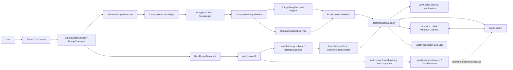
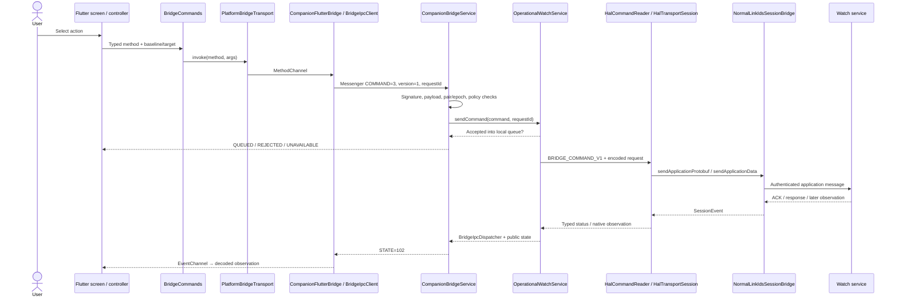
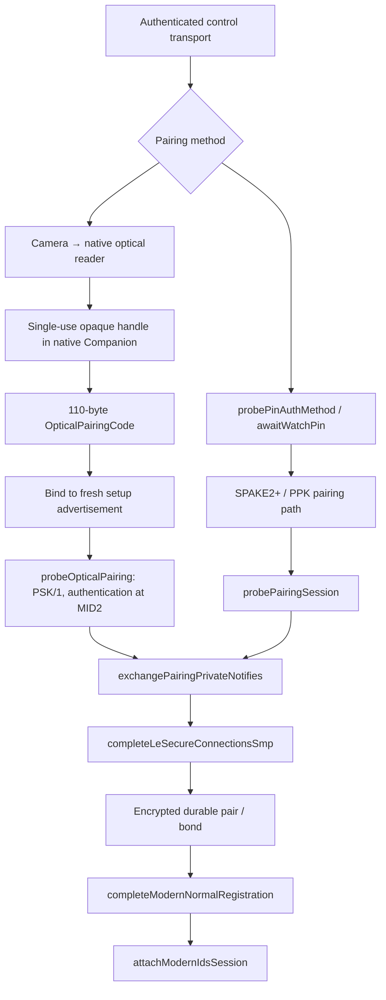
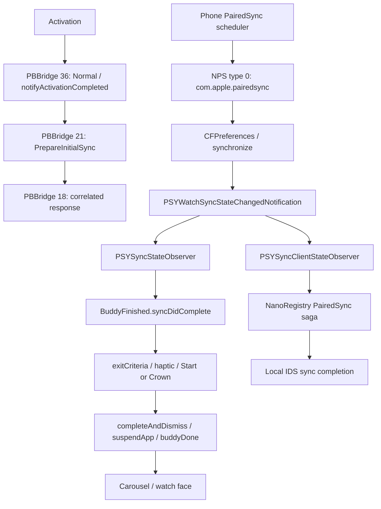
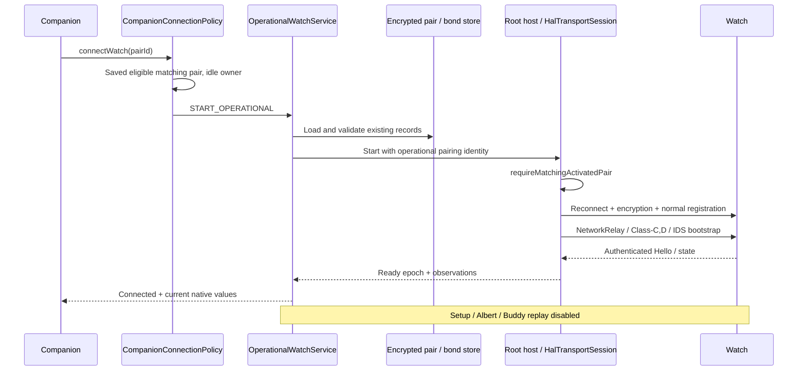
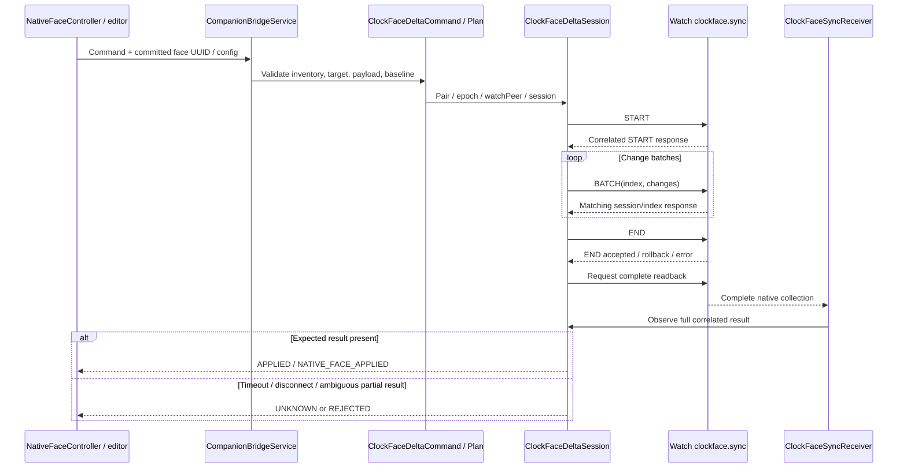
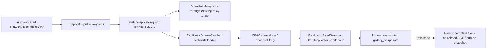

<p align="center">
  
</p>

<h1 align="center">Apple Watch Companion</h1>

<p align="center">
  <strong>Android · macOS · Linux · Windows</strong><br>
  네이티브 프로토콜. 실제 하드웨어. 하나의 Companion.<br>
  Bluetooth · 페어링 · IDS · 네이티브 페이스 · Flutter · Java · Rust
</p>

<p align="center">
  <a href="README.md#english">English</a> ·
  <a href="README.md#russian">Русский</a> ·
  <strong>한국어</strong> ·
  <a href="https://www.youtube.com/watch?v=5zvBRTuSM30">Android 연결 시연</a> ·
  <a href="docs/DONATIONS.md">개발자 후원</a>
</p>

<p align="center">
  <a href="#ko-start">시작하기</a> · <a href="#ko-calls">호출 흐름</a> · <a href="#ko-pairing">페어링</a> · <a href="#ko-api">API</a> · <a href="#ko-build">빌드</a> · <a href="#ko-evidence">검증 자료</a>
</p>

---

<a id="korean"></a>

## 한국어

<h2 align="center">⚠️ watchOS 26.2 (23S303)에서만 테스트되었습니다</h2>

**Android Magisk 모듈:** [Bridge 0.2.427 ZIP 다운로드](https://github.com/LordixDemon/apple_watch_connector/releases/download/magisk-0.2.427/apple-watch-bridge-magisk-0.2.427.zip) · [설치 방법](#ko-android-install)

**네이티브 Bluetooth/IDS 프로토콜과 공통 Flutter Companion으로 Apple Watch를 Android, Linux, Windows에 연결합니다. macOS도 같은 인터페이스를 사용하지만 Bluetooth 백엔드 기능은 제한적입니다.**

이 프로젝트는 기기 검색과 페어링부터 활성화, 재연결, 환경설정 교환, 네이티브 시계 페이스 관리까지의 과정을 재구현합니다. Companion은 네 플랫폼 모두에서 관측된 워치 상태를 표시하고 명령을 전달합니다. Android Bridge는 휴대폰의 연결과 키를 관리합니다. Linux와 Windows는 Rust 데스크톱 백엔드, 네이티브 HCI 브로커, 공통 Java 프로토콜 엔진을 사용하며, macOS는 Rust와 CoreBluetooth를 사용합니다. Linux와 Windows에서는 워치의 6자리 코드로, Android에서는 카메라로도 페어링할 수 있습니다.

릴리스 준비 과정에는 공통 Java `protocol-runtime` 모듈, 분리된 연구·디버그 검사 도구, Linux 산출물 검사, 공통 Android 배포 서명이 포함됩니다. [릴리스 가이드](docs/BUILD_AND_RELEASE.md)를 참고하세요. Linux와 Windows의 새 페어링, 활성화, 동일 페어링을 이용한 암호화 재연결은 테스트한 하드웨어에서 실물 검증을 마쳤습니다. 데스크톱의 앱 서비스 지원은 아직 부분적입니다.

Linux Rust 백엔드는 관측 상태, 워커의 I/O와 수명, 명령 라우팅을 분리합니다. 중지·실패 상태에서는 뒤늦게 도착한 준비 완료 이벤트를 거부하며, EOF 처리와 시간 제한이 있는 정리 절차로 오래된 준비 상태나 방치된 워커를 방지합니다. 이식 가능한 Java 모듈은 엄격한 의존성 잠금을 공유합니다. Linux 패키지는 검증된 스키마 2 인벤토리와 결정적 아카이브 메타데이터를 사용합니다. [93단계](docs/REFACTOR_RELEASE_93.md)를 참고하세요. Linux에서는 모든 시계 화면에서 Bluetooth 어댑터를 선택할 수 있으며, HCI 인덱스가 바뀌어도 주소를 기억합니다. 저장된 하드웨어가 없으면 다시 선택해야 합니다. [어댑터 선택](docs/LINUX_ADAPTER_SELECTION_94.md)을 참고하세요.

> **원문 문서 기준일: 2026년 10월 13일.** 주요 검증 기기는 Apple Watch Ultra 2, `Watch7,5`, watchOS `26.2 / 23S303`입니다. 소스 버전은 Bridge **0.2.429 / 코드 629**, Companion **1.0.86+87**, Rust 워크스페이스 **0.1.1**입니다. 소스 버전만으로 실제 설치된 버전을 알 수는 없습니다. Android 카메라 페어링, Mint 22.3의 Linux 페어링, Windows 10 / Realtek `0bda:b00e`의 Windows 페어링은 각각 별도로 실물 검증했습니다.

개발은 진행 중입니다. 하드웨어 기록에서 카메라 페어링, 활성화, 시계 페이스 표시를 확인했습니다. Watch.app과의 완전한 동등성, 모든 iPhone 기능, 모든 Apple Watch 모델의 호환성은 아직 확보되지 않았습니다. macOS의 기기 검색은 구현되었지만 실제 기기에서의 전체 페어링 → 활성화 → IDS 경로는 미완성입니다.

## 목차

- [기능과 검증 범위](#ko-status)
- [프로젝트 구조](#ko-layout)
- [시스템 아키텍처](#ko-architecture)
- [전체 호출 흐름](#ko-calls)
- [프로토콜 스택](#ko-stack)
- [새 페어링 단계별 설명](#ko-pairing)
- [활성화 및 초기 설정 완료](#ko-setup)
- [일반 재연결](#ko-reconnect)
- [Companion → Bridge 전체 API 목록](#ko-api)
- [IDS 경로와 핸들러](#ko-routes)
- [네이티브 페이스: 읽기, 변경, 가져오기, 리소스](#ko-faces)
- [설정, 색상 및 모노그램](#ko-preferences)
- [알림, 기기 찾기, Wi-Fi 및 건강](#ko-features)
- [최신 StateReplicator 및 QUIC](#ko-replicator)
- [키, 저장소 및 소유권](#ko-ownership)
- [새 환경에서 시작하기](#ko-start)
- [빌드, 테스트 및 첫 실행](#ko-build)
- [macOS 검색용 빌드](#ko-macos)
- [Linux 연결 및 어댑터 선택](#ko-linux)
- [Windows 연결](#ko-windows)
- [업데이트, 백업 및 롤백](#ko-update)
- [진단 및 연구 명령](#ko-diagnostics)
- [소스 및 검증 자료 안내](#ko-evidence)
- [용어 설명](#ko-glossary)

<a id="ko-status"></a>

## 기능과 검증 범위

아래 표는 소스에 구현된 내용과 보관된 실물 검증 자료를 구분합니다. 자세한 내용은 [기능 목록](docs/WATCH_FEATURE_REGISTRY.md)과 [검증 계획](docs/WATCH_FEATURE_COVERAGE_PLAN.md)을 참고하세요. 오래된 기록은 이후 단계에서 대체되었을 수 있습니다.

릴리스 상태는 **실험적 RC**입니다. [플랫폼 지원 표 및 테스트 버전](docs/BUILD_AND_RELEASE.md#candidate-versions-and-support), [변경 기록](CHANGELOG.md)을 참고하세요. 아래 앱 서비스는 별도 명시가 없으면 Android 기준입니다. Linux/Windows는 현재 연결·설정 제어를, macOS는 BLE 검색·링크를 제공합니다. UI의 사용 가능한 기능 패널은 연결 준비 상태와 별개로 백엔드가 선언한 지원 범위를 표시합니다.

| 영역 | 구현 경로 | 검증 자료 및 제한 |
| --- | --- | --- |
| Android 검색 / 페어링 | 실제 검색, 명시적 선택, PIN 및 광학 PSK 경로 | [광학 보고서](docs/live-20261006-optical-pairing/RESULT.md)에서 카메라 페어링, 활성화, 페이스 표시를 확인. 특정 하드웨어에서 검증 |
| 활성화 / 초기 설정 | PBBridge, 초기 속성, 워치 언어, PairedSync, 완료 정책 | 활성화, UI 완료, 일반 동작 준비는 별도 조건. [완료 보고서](docs/SETUP_COMPLETION_388.md)는 네이티브 증거와 소유자 확인을 구분 |
| 일반 재연결 | 저장된 활성화 페어링, 암호화 링크, IDS, 별도 포그라운드 서비스 | 연결 시 페어링이나 초기 설정을 반복하지 않음. 연결 상태와 최신 배터리 값을 실물 검증 |
| 배터리 / 정보 | 네이티브 관측 및 SystemSettings 요청 | [배터리 검증](docs/live-20261005-sync/BATTERY-346-HARDWARE-EVIDENCE.md). 받지 못한 값은 알 수 없음으로 유지 |
| Wi-Fi | 현재 휴대폰 네트워크 → 네이티브 V2 ADD | 실물 보고서에서 네트워크 수신과 워치의 접속을 확인. 지원되는 WPA2-PSK/CCMP 네트워크로 제한 |
| 네이티브 페이스 | 목록, 선택, 복제, 삭제, 순서 변경, 업데이트, 추가, 리소스, 내보내기 | 네이티브 목록과 로컬 디자인은 별개. 변경은 다시 읽어 확인해야 하며 페이스 계열·미리보기 지원은 확장 중 |
| Watch.app UI / 미리보기 | 네이티브 카탈로그, 옵션, 팔레트·색조, 사진, 모노그램, AppIntent 메타데이터 | 완전한 시각적 일치와 최적화는 미완성. 90단계 색상 견본 컴포넌트는 연구 결과이며 실제 UI 통합은 대기 중 |
| 설정 | `RIGHT_WRIST`, `INVERT_SCREEN`, `TIME_24_HOUR` | 정확한 NPS 키 허용 목록 사용. 다른 설정 화면이 있다고 해서 네이티브 쓰기를 지원하는 것은 아님 |
| 알림 | Bulletin 전송, Android 리스너, 리비전에 연결된 동작 | 전송·핸들러는 구현됨. 모든 앱, 첨부, 소리, 실제 동작은 별도 검증 필요 |
| 기기 찾기 | 휴대폰 → 워치 소리, 워치 → 휴대폰 효과·결과 | 수신 확인과 물리적 효과는 별개. 소리·플래시는 Android 권한 및 휴대폰 상태에 의존 |
| 건강 | 암호화 수신, 재전송 처리, 피어·레지스트리 연결, 디코딩, 기본값 미러 | 건강·활동 데이터의 완전한 가져오기, 올바른 앵커, 모든 데이터 형식을 보장하지 않음 |
| 전화 / SMS / 연락처 | 연구용 코덱과 일부 Flutter 메서드 | 현재 Companion IPC는 `triggerCall`, `callAction`을 구현하지 않음. 전체 통화·오디오는 미검증 |
| StateReplicator | 인증된 검색, 고정 키 QUIC, 네이티브 프레이밍, 핸드셰이크 | 전체 네이티브 스냅샷·파일 수신과 영구 저장은 미완성 |
| macOS | 공통 Flutter UI, Rust C ABI, CoreBluetooth 검색·BLE, 이식 가능한 페어링 코덱 | 전체 실물 페어링·IDS에는 허용된 부트스트랩 전송 경로가 필요 |
| Linux | Rust HCI 브로커 + 공통 Java 프로토콜 + Flutter UI | Mint 22.3에서 실물 페어링·활성화·재연결 검증. Wi-Fi 자격 증명 및 앱 서비스는 미완성 |
| Windows | 네이티브 Rust USB HCI + 공통 Java 프로토콜 + Flutter UI, DPAPI 저장 | Windows 10 / Realtek `0bda:b00e` / Watch7,5에서 PIN·활성화·암호화 재연결 실물 검증. 다른 하드웨어와 전체 앱 서비스는 미검증 |

<a id="ko-layout"></a>

## 프로젝트 구조

```text
.
├── apple-watch-companion/       Shared Flutter UI; Android IPC and desktop Rust FFI
├── apple-watch-bridge/
│   ├── core/                   Java wire codecs, crypto, policies, mirrors, JVM tests
│   ├── protocol-runtime/       Shared controller/session/stdin runtime; no Android SDK
│   ├── hal/                    Android root entry, Bluetooth HAL and file ownership adapters
│   └── app/                    Android services, Keystore/SQLite, permissions, IPC
├── crates/
│   ├── watch-protocol/         Rust framing, FE25 advertisements, BT_CL normal handoff
│   ├── watch-pairing/          Portable uIKE control/PIN security; no OS I/O
│   ├── watch-core/             Sessions, observations, transport interface
│   ├── watch-transport-macos/  CoreBluetooth ownership and callbacks
│   ├── watch-transport-linux/  Desktop worker, Linux HCI and Windows USB HCI brokers
│   ├── watch-transport-windows/ WinRT discovery/BLE diagnostic transport
│   ├── watch-core-ffi/         Versioned C ABI for Flutter desktop
│   └── watch-replicator-quic/  Socket-free pinned QUIC engine and Android JNI
├── src/                        Compatibility facade and USB framing utilities
├── tools/                      Builds, native captures, asset builders, verification
├── linux-watch-host/           Linux protocol host
├── windows-watch-host/         Windows protocol host and DPAPI storage
└── docs/                       Architecture, protocol documentation and verification
```

빌드 경계는 [Gradle 설정](apple-watch-bridge/settings.gradle)과 [Cargo 워크스페이스](Cargo.toml)에서 정의합니다. `artifacts/`, `target/`, `build/`, 과거의 `source-before/` 트리에는 현재 앱 소스에 속하지 않는 파일이 많이 있습니다.

<a id="ko-architecture"></a>

## 시스템 아키텍처



Android Bridge APK 하나에 `app`, `hal`, `protocol-runtime`, `core`, QUIC `.so`가 포함됩니다. Companion은 별도의 APK입니다. Java 패키지 `dev.applewatchandroid.bridge`는 모듈 간에 공유하며 컴파일 의존 관계는 `app → hal → protocol-runtime → core`, `app → core`입니다. Linux와 Windows 워커는 플랫폼별 컨트롤러·저장소 어댑터와 함께 `protocol-runtime`, `core`를 재사용합니다. Rust는 데스크톱 워커의 수명과 공개 상태를 관리하며 Flutter는 C ABI로 접근합니다.

사용자의 연결 흐름은 Flutter가 담당합니다. Bridge 실행기는 Companion으로 연결합니다. 화면을 닫아도 일반 연결용 포그라운드 서비스는 계속 실행됩니다. HAL 소유자는 하나이며 직렬 전송 상태 머신 하나가 패킷 순서를 관리합니다.

자세한 내용: [Bridge 아키텍처](docs/BRIDGE_ARCHITECTURE.md), [Companion 아키텍처](docs/COMPANION_ARCHITECTURE.md), [macOS Rust 코어](docs/MACOS_RUST_CORE.md).

<a id="ko-calls"></a>

## 전체 호출 흐름

아래 흐름은 구현된 계층 간 전환과 주요 호출을 나타냅니다. 화살표는 작업 방향이며 일부 전환은 비동기 대기열입니다. 특정 분기의 실행 여부는 소스 조건과 런타임 증거로 판단해야 합니다.

### Companion → 워치 명령



페어링·활성화에는 `BridgeSetupService`를 사용합니다. 큰 `.watchface` 패키지는 변경 명령 전에 `NativeFaceTransferDispatcher`를 거칩니다. Companion이 IPC에 바인딩되는 것만으로 HAL이 시작되거나 페어링이 생성되지는 않습니다.

### 워치 → UI 관측

```text
Watch packet
  → Bluetooth HAL callback / HCI ACL
  → HalTransportSession
  → NormalLinkIdsSessionBridge.accept…
  → normal link: ERTM / NetworkRelay / authenticated ESP
  → IDS: IPv6 / TCP / NWSC / control or application stream
  → IdsModernSessionCoordinator.SessionEvent
  → handleIncomingProtobufEvent / feature receiver / typed observation
  → root stdout IPC → OperationalWatchService
  → BridgeIpcDispatcher + CompanionSessionState
  → CompanionBridgeService.state() / STATE=102
  → BridgeIpcClient → BridgeStateProjection
  → EventChannel → WatchBridgeService / BridgeObservation
  → WatchObservationController / WatchConnectionProvider / feature controller
  → Provider → widgets
```

게시 데이터는 전체를 디코딩한 뒤 각 표시용 상태로 전달합니다. 전송 연결이 끊기거나 페어링이 바뀌면 연결·네이티브 상태를 무효화합니다. 이전 epoch의 지연 응답으로 오래된 상태가 복구되어서는 안 됩니다.

### 각 확인 단계의 의미

| 값 / 이벤트 | 의미 |
| --- | --- |
| `QUEUED` | Bridge가 로컬 대기열에 요청을 수락함 |
| `HAL_ACCEPTED` | 루트 전송 계층이 구조화된 요청을 수락함 |
| `IDS_QUEUED` | IDS가 메시지를 할당함. 메시지 UUID로 연결 |
| `APP_ACK_RECEIVED` | 해당 앱 확인 응답이 도착함 |
| `APP_RESPONSE_RECEIVED` | 해당 앱 응답이 도착함. 의미는 프로토콜별로 다름 |
| `NATIVE_FACE_APPLIED` | 서로 대응하는 워치 데이터를 완전히 다시 읽어 페이스 트랜잭션을 확인함 |
| `APPLIED` | Flutter의 확인 래퍼가 수락하는 값. 대기열·ACK만으로 추정할 수 없음 |
| `EXPIRED`, `FAILED`, `REJECTED`, `UNKNOWN` | 서로 다른 미완료 결과. `UNKNOWN`이어도 일부 효과가 발생했을 수 있음 |
| `OBSERVED` | 공개 상태 읽기 응답. 각 필드의 최신성은 별도 확인 필요 |

단계 열거형은 [BridgeCommandCodec](apple-watch-bridge/core/src/main/java/dev/applewatchandroid/bridge/BridgeCommandCodec.java)에 정의되어 있습니다. 모든 요청이 같은 선형 파이프라인을 따르지는 않습니다. 요청마다 단계가 다르며 저장된 스냅샷은 오래된 것일 수 있습니다.

<a id="ko-stack"></a>

## 프로토콜 스택

### 링크 수립

```text
BLE advertisement / FE25 setup metadata
  → explicitly selected fresh Watch candidate
  → HCI LE connection
  → L2CAP
  → BT_CL fixed signaling CID 0x003a
  → VERSION / services / CREATE / ACCEPT
  → dynamic pairing pipe
  → uIKE security + PIN/optical authentication
  → OOB / LE Secure Connections SMP / durable Bluetooth bond
  → encrypted normal-link registration
```

### 일반 링크의 IDS 앱 트래픽

```text
Application protobuf / binary plist / resource / native face payload
  ↕ IDS application stream + ServiceMap topic
  ↕ NWSC service connector + TCP + inner IPv6
  ↕ authenticated ESP / Class-C or Class-D IPsec
  ↕ NetworkRelay
  ↕ L2CAP ERTM on negotiated dynamic channels
  ↕ HCI ACL
  ↕ Android Bluetooth HAL / controller
  ↕ BLE link
```

[NormalLinkIdsSessionBridge](apple-watch-bridge/core/src/main/java/dev/applewatchandroid/bridge/NormalLinkIdsSessionBridge.java)가 경계를 정의합니다. 일반 링크는 IKE/ESP/NetworkRelay/ERTM을, IDS는 복호화된 IPv6/TCP, NWSC, 제어·데이터 스트림을 담당합니다. IKE가 보안 연결(SA)을 수립하고 일반 앱 페이로드는 ESP를 통해 전송됩니다.

**토픽마다 별도의 TCP 연결이 생기는 것은 아닙니다.** 우선순위와 보호 클래스가 같은 서비스는 동일한 표준 커넥터를 공유합니다. Class-C/D는 보호된 경로의 구분이며, 별도의 앱이나 무선 채널이 아닙니다.

<a id="ko-pairing"></a>

## 새 페어링 단계별 설명

### 1. 세션 소유자 허용

Companion이 `beginPairing` 또는 `beginOpticalPairing`을 호출합니다. `CompanionConnectionPolicy`는 Bluetooth 권한, 알려진 저장 식별 정보, 독점 소유권을 검사합니다. 일반 시작 요청은 저장된 페어링을 교체하지 않습니다. 명시적 `replacePairOptically`에는 현재 저장된 페어링 UUID와 검증된 암호화 교체 백업이 필요합니다.

### 2. 루트 컨트롤러 런타임 시작

`BridgeSetupService / BridgeSetupEngine → RootBluetoothHalHost → HalTransportSession.initialize() → runTransportHandshake()`.

루트 호스트가 호출을 검증하고 독점 HAL 임대를 얻습니다. 전송 계층은 컨트롤러를 구성하고 앱에서 안정적인 로컬 식별 정보를 받아 ACL 버퍼·크레딧과 이벤트 마스크를 설정합니다. MainActivity는 이 프로세스의 소유자가 아닙니다.

### 3. 실제 워치 검색 및 선택

스캔으로 광고 데이터를 받습니다. 유효한 설정 메타데이터로 제품·watchOS·후보 정보를 식별합니다. `WatchDiscoverySelection`은 수량이 제한된 임시 토큰을 게시합니다. Companion이 `selectDiscoveredWatch`를 보내면 사용 전에 최신성을 다시 검사합니다. 제조사 데이터만으로 페어링 가능 여부를 확정할 수 없습니다.

### 4. 페어링 전송 경로 열기

LE 연결 후 BT_CL이 버전·서비스·CREATE·ACCEPT를 협상합니다. 동적 CID는 상수가 아니라 협상으로 결정됩니다. HAL에서는 `probeControlSaInit()`에 도달합니다.

### 5. 제어 보안 수립

[HalTransportSession](apple-watch-bridge/protocol-runtime/src/main/java/dev/applewatchandroid/bridge/HalTransportSession.java)의 호출:

```text
runTransportHandshake()
  → probeControlSaInit()
  → probeAdditionalKeyExchange()
  → probeControlIkeAuth()
  → selected authentication branch
```

이 과정은 보안을 협상하고 인증된 페이로드를 검증합니다. 이 시점에는 영구 본딩, IDS 준비, 활성화가 아직 완료된 것이 아닙니다.

### 6. PIN 또는 광학 페어링 인증



PIN과 광학 페어링은 인증 경로와 메시지 카운터가 다릅니다. 광학 코드는 최신 설정 광고 데이터와 연결됩니다. 이미지를 디코딩한 것만으로 페어링이 인증되지는 않습니다.

Android 카메라 리더는 별도의 네이티브 `:optical` 프로세스에서 실행됩니다. Dart는 공개 이름과 임시 핸들을 받습니다. 사용자가 페어링·교체를 명시적으로 선택하면 서명으로 보호된 IPC를 통해 네이티브 페이로드를 전달합니다. 핸들은 일회용이며 문서상 수명은 120초, 요청 제한 시간은 10초입니다.

현재 공간 패턴 리더는 빌드 시 생성하는 로컬 해시 고정 `23G71` 펌웨어 기반의 과도기 백엔드를 사용합니다. 독립적으로 이식 가능한 공간 패턴 검출기는 아직 미완성입니다. Arm64를 지원하며 다른 네이티브 ABI는 초기화를 거부합니다. 필수 바이너리 입력을 임의의 파일로 대체할 수 없습니다.

### 7. 보안 자료와 본딩 영구 저장

`exchangePairingPrivateNotifies()`에서 OOB/SMP 및 `completeLeSecureConnectionsSmp()`로 이어집니다. 앱은 기록을 암호화·보호하고 저장 결과를 루트에 돌려줍니다. `BOND-STORED` / `PAIRING-SESSION-STORED`는 단순 저장 요청과 다릅니다. 저장에 실패했다면 커밋 성공으로 진행할 수 없습니다.

### 8. 일반 링크 및 IDS 수립

`completeModernNormalRegistration() → attachModernIdsSession()`에서 일반 통신 경로와 보호된 라우트를 수립합니다. NetworkRelay/IKE Class-D와 Class-C 수립 후 IDS 제어 Hello, 서비스 라우팅, 데이터 경로가 이어집니다. 이후 기기 정보와 NanoRegistry 속성을 교환합니다.

소스: [광학 결과](docs/live-20261006-optical-pairing/RESULT.md), [형식화된 설정 상태 흐름](docs/live-20261006-optical-pairing/SETUP-387-STATE-CHAIN.md), [PairingSessionRecord](apple-watch-bridge/core/src/main/java/dev/applewatchandroid/bridge/PairingSessionRecord.java).

<a id="ko-setup"></a>

## 활성화 및 초기 설정 완료

### 보안 및 IDS 이후 순서

| 단계 | 담당 / 데이터 | 전환 조건 |
| --- | --- | --- |
| 1. IDS 부트스트랩 | `IdsModernSessionCoordinator`, `IdsBootstrapState`, 기기 정보 | 인증된 식별 정보와 동작 중인 제어·데이터 경로 |
| 2. 초기 레지스트리 | `AppleWatchInitialSetupIdsAdapter`, NanoRegistry 속성 | 필수 속성 수신 및 식별 정보 조정 완료 |
| 3. 언어 / 로캘 | `WatchLocaleSnapshot`, 환경설정 아카이브 | 인증된 워치 언어·로캘만 사용. Android 로캘로 대체하지 않음 |
| 4. `isPaired` 커밋 | 초기 설정 코디네이터와 영구 기록 | 필수 체크포인트·장벽이 유효함 |
| 5. 활성화 | `HalPostCommitOrchestrator`, `ActivationProxyWorker`, PBBridge | 실제 활성화 결과. 소유자 입력은 별도 전달 |
| 6. 일반 연결 / 초기 동기화 준비 | PBBridge 36, 이어서 21 / 응답 18 | 대응하는 응답 수신. 설정 완료를 의미하지 않음 |
| 7. Wi-Fi | `InitialWifiSyncWorker` | 지원 네트워크, 같은 페어링·세대, 활성 설정 Class-C 경로 |
| 8. PairedSync | NPS 도메인, 활성·완료 동기화 상태 | 단순 진행 문구가 아닌 네이티브 관찰자·사가 조건 |
| 9. 초기 설정 종료 | Buddy / Carousel 및 완료 정책 | 별도의 네이티브 증거 또는 페이스 표시를 본 소유자의 명시적 확인 |
| 10. 일반 재연결 | 일반 연결 정책 | 조건을 충족한 동일 저장 페어링, 설정 전송 경로의 안전한 중지 |

### 바이너리에서 재구성한 워치의 네이티브 경로



서로 독립적인 관찰자 분기가 두 개 있습니다. PBBridge 4 활성화, 응답 18, AppACK, 진행률 전송만으로 시계 화면 표시를 각각 확정할 수 없습니다. 정확한 핸들러와 빌드별 차이(`23S303`, `23U67`, `23G71`)는 [SETUP_CHAIN.md](docs/live-20261005-sync/SETUP_CHAIN.md)에 기록되어 있습니다.

### 공개 단계 및 영구 체크포인트

`SetupProgressState.Phase` 정의:

```text
IDLE, STARTING, DISCOVERING, CONNECTING, PIN_REQUIRED, SECURITY, IDS,
REGISTRY, CONFIGURING, ACTIVATING, ACTIVATION_INPUT, ACTIVATED, SYNCING,
WAITING_FOR_WATCH, VERIFYING_RECONNECT, VERIFIED, FAILED, STOPPING, STOPPED
```

이는 표시용 상태의 용어이며 모든 시나리오에 강제되는 하나의 순서가 아닙니다. `BridgeSetupEngine`은 상태의 역행을 방지하고 지연된 소유자 입력 필드를 지웁니다.

`PairingSessionRecord`는 영구 저장용 와이어 번호를 유지합니다.

| 값 | 체크포인트 | 값 | 체크포인트 |
| ---: | --- | ---: | --- |
| 1 | `PAIRING_MATERIAL_PERSISTED` | 10 | `INITIAL_PROPERTIES_RECEIVED` |
| 2 | `SMP_BONDED_RAW` | 11 | `READY_TO_COMMIT_IS_PAIRED` |
| 3 | `STOCK_BOND_IMPORTED` | 12 | `IS_PAIRED_COMMITTED` |
| 4 | `STOCK_ENCRYPTED_RECONNECT` | 13 | `ACTIVATION_CONFIRMED` |
| 5 | `NETWORK_RELAY_PRELUDE_NEGOTIATED` | 14 | `IS_SETUP_CONFIRMED` |
| 6 | `CLASS_D_ESTABLISHED` | 15 | `PAIRED_SYNC_COMPLETE` |
| 7 | `CLASS_C_ESTABLISHED` | 16 | `SETUP_COMPLETE` |
| 8 | `IDS_CONTROL_READY` | 17 | `CLOCK_VISIBLE_CONFIRMED` |
| 9 | `IDS_DATA_READY` | 18 | `OPERATIONAL_HEALTH_CONFIRMED` |

플래그, 검증 자료, 식별 정보도 함께 검사합니다. 번호가 높다는 이유만으로 일반 연결 모드를 허용하지 않습니다. 소유자 확인은 네이티브 증거와 별도로 저장합니다. 관측되지 않은 과거의 종료 기록은 일반 재연결 자격을 자동으로 얻지 않습니다.

<a id="ko-reconnect"></a>

## 일반 재연결



`OperationalWatchService`는 루트 수명, 준비 상태 epoch, 크기가 제한된 명령 대기열, 재연결을 관리합니다. 기능 컨트롤러는 `OperationalSessionAccess`를 받으며 두 번째 루트 소유자를 시작하거나 페어링을 교체할 수 없습니다.

재시도가 허용된 경우 실패 횟수에 따른 지연은 **15 → 30 → 60초**입니다. IDS 정책 거부나 미완료 페어링 커밋으로 재연결이 금지될 수 있습니다. 타이머는 이런 조건을 우회하지 않습니다.

연결 해제 시 자원을 정리하고 소유권을 반환합니다. `STOPPING` 중에는 다른 흐름이 HAL을 얻을 수 없습니다. 재연결에는 새 전송 epoch가 부여되며 이전 명령은 무효화됩니다.

<a id="ko-api"></a>

## Companion → Bridge 전체 API 목록

현재 Android IPC 핸들러와 별도의 로컬 어댑터 메서드 목록입니다. 인자는 요약한 것이며 정확한 검증·크기 규칙은 링크된 구현을 참고하세요. 서명된 두 앱 사이의 내부 API입니다.

### IPC 규약

| 계층 | 규약 |
| --- | --- |
| Flutter 명령 | MethodChannel `dev.applewatchandroid.companion/bridge` |
| Flutter 관측 | EventChannel `dev.applewatchandroid.companion/events` |
| 네이티브 서비스 | `dev.applewatchandroid.bridge.CompanionBridgeService` |
| 권한 | `dev.applewatchandroid.bridge.permission.COMPANION_IPC`, `signature` 보호 |
| Messenger 요청 | `1 = SUBSCRIBE`, `2 = GET_STATE`, `3 = COMMAND` |
| Messenger 응답 | `101 = RESPONSE`, `102 = STATE` |
| 봉투 | `version=1`, 표준 형식 `requestId` UUID. 명령에는 `method`와 형식이 지정된 Bundle 인자 포함 |
| 접근 허용 | Companion 패키지 및 일치하는 서명. 구독 클라이언트 최대 4개 |
| Companion 클라이언트 | 대기 요청 최대 32개, 제한 시간 5초, 바인딩 종료 복구 |
| 루트 명령 | `BRIDGE_COMMAND_V1:` + Base64 바이너리 요청 `{id, epoch, deadlineMs, command}` |
| 루트 상태 | `BRIDGE_COMMAND_STATUS_V1:` + Base64 형식화된 상태 |

로컬 텍스트·파일 어댑터는 별도의 `…/text`, `…/face_files` 채널을 사용합니다. 이 작업들은 워치 IDS 명령이 아닙니다.

### 연결 및 초기 설정

| 메서드 | 경로 / 조건 |
| --- | --- |
| `connectWatch` | `START_OPERATIONAL`: 조건을 충족한 동일 저장 페어링 |
| `disconnectWatch` | `STOP_SESSION`: 설정 또는 일반 연결 소유자 |
| `beginPairing` | `START_SETUP`: 저장된 페어링 없음 |
| `beginOpticalPairing` | `START_SETUP`: 네이티브 광학 페이로드 및 저장된 페어링 없음 |
| `replacePairOptically` | 명시적 교체: 일치하는 저장 페어링, 광학 코드, 검증된 백업 |
| `resumeSetup` | 일치하는 저장 페어링이 아직 operationalEligible 상태가 아님 |
| `submitPin` | 현재 설정 소유자에게 전달 |
| `selectDiscoveredWatch` | 임시 검색 토큰을 설정 흐름으로 전달 |
| `activationResponse` | 활성화 확인 요청에 대한 응답을 설정 흐름으로 전달 |
| `confirmSetup` | 활성화된 일치 페어링. 소유자 확인을 통한 안전한 완료 |
| `finishSetup` | 명시적 `REJECTED` 정책. 과거의 강제 완료 비활성화 |
| `auditStockBond` | 일치하는 페어링의 별도 설정 진단 흐름 |
| `importStockBond` | 보호 조건이 있는 시스템 본딩 가져오기 |
| `alignStockIdentity` | 보호 조건이 있는 시스템 식별 정보 진단 |
| `probeStockReconnect` | 보호 조건이 있는 시스템 재연결 검사 |

소스: [연결 정책](apple-watch-bridge/core/src/main/java/dev/applewatchandroid/bridge/CompanionConnectionPolicy.java), [IPC 서비스](apple-watch-bridge/app/src/main/java/dev/applewatchandroid/bridge/CompanionBridgeService.java).

### 일반 동작 명령

| 메서드 | 인자 / 명령 | 완료 증거 |
| --- | --- | --- |
| `pingWatch` | `PING_WATCH` → FindMyLocalDevice | 대응하는 응답. 실제 소리는 별도 검증 |
| `refreshWatchState` | `REQUEST_DEVICE_ABOUT` | SystemSettings 정보 응답 / 원격 측정 |
| `refreshFaceCollection` | `REQUEST_FACE_COLLECTION` | 완전하고 수락된 네이티브 페이스 모음 스냅샷 |
| `syncWifi` | `SYNC_CURRENT_WIFI` | V2 아카이브 전달. 네트워크 접속은 별도 확인 |
| `setActiveFace` | `faceId` → `NATIVE_FACE_SELECT:` | 새로 확인된 선택 UUID |
| `duplicateNativeFace` | `sourceFaceId`; requestId에서 새 UUID 생성 | 다시 읽은 데이터의 새 페이스·아카이브 |
| `removeNativeFace` | `faceId` | 다시 읽은 데이터에 UUID가 없음. 마지막 페이스 삭제 불가 |
| `reorderNativeFaces` | `faceIds`의 정확한 순열 | 다시 읽은 전체 순서가 일치함 |
| `updateNativeFace` | `faceId`, 바이너리 `configuration` | 다시 읽은 구성이 일치함 |
| `addNativeFace` | `.watchface` `archive`, 인라인 최대 128 KiB | 다시 읽은 새 대상 UUID 및 아카이브 |
| `setNativeMonogram` | `pairId`, `epoch`, `revision`, `text` | 페어링에 연결된 새 모노그램 관측 |
| `setNativePigmentVisibility` | 페어링·epoch, 타임스탬프, 전체 기준 집합, `changes` | 페어링별 색상 미러. 대기열·ACK만으로는 불충분 |
| `setWatchSetting` | `setting`, 불리언 `value` | 정확한 키의 네이티브 NPS 관측 |
| `sendNotification` | `title`, `message`, `sectionId`, `sectionDisplayName` | 네이티브 알림 경로. 카드·동작은 별도 확인 |
| `stopPhonePing` | 로컬 Android 효과 중지 | 로컬 중지 성공 시 `STOPPED` |

일반 연결 서비스가 준비 상태·정책을 확인하고 루트가 봉투를 다시 검증합니다. 페이스 작업에는 알려진 현재 목록도 필요합니다. 루트는 과거의 `SET_ACTIVE_FACE:`를 거부하며 네이티브 페이스 모음 프로토콜을 요구합니다.

### 아카이브 및 로컬 플랫폼 작업

| 메서드 | 동작 |
| --- | --- |
| `beginNativeFaceImport` | 선언된 총크기로 페어링·epoch에 연결된 업로드 생성. 리소스용 faceId/baselineHash는 선택 사항 |
| `appendNativeFaceImport` | 오프셋을 검증하며 청크를 순서대로 추가 |
| `finishNativeFaceImport` | 패키지 검증·봉인 후 네이티브 추가·리소스 명령을 대기열에 넣음 |
| `cancelNativeFaceImport` | 미완료 업로드 취소 |
| `exportNativeFace` | 오프셋·총크기·SHA-256을 포함한 저장된 네이티브 패키지의 청크 내보내기 |
| `getState` | `client.observedState` 반환. 워치에 최신 상태를 요청하지 않음 |
| `requestConnectionPermissions` | 연결 범위의 Bridge 권한 화면 열기 |
| `requestPhoneFlashPermission` | 권한 화면 열기. `OPENED`는 권한 허용을 뜻하지 않음 |
| `startOpticalDecoder` | 선언된 너비·높이로 네이티브 광학 워커 시작 |
| `processOpticalFrame` | 크기가 제한된 패킹 UV 프레임 전달. IDS 패킷이 아님 |
| `stopOpticalDecoder` | 리더·워커 자원 닫기 |
| `discardOpticalCandidate` | 임시 네이티브 후보 핸들 폐기 |

업로드·내보내기는 [NativeFaceTransferDispatcher](apple-watch-bridge/app/src/main/java/dev/applewatchandroid/bridge/NativeFaceTransferDispatcher.java)가 담당하며 패키지 저장소도 제한과 수명을 확인합니다. `replaceNativeFaceResources`는 Dart 업로드 래퍼이며 별도의 Bridge IPC 메서드가 아닙니다.

### 현재 Android 구현이 없는 Flutter 메서드

| 메서드 | 실제 동작 |
| --- | --- |
| `syncSettings` | 어댑터 오류 `UNIMPLEMENTED`. 지원되는 키별 `setWatchSetting` 사용 |
| `unpairWatch` | 어댑터 오류 `UNIMPLEMENTED`. Dart 설명만으로 초기화가 구현되는 것은 아님 |
| `triggerCall` | 어댑터 오류 `UNIMPLEMENTED`. 전화 코덱·토픽만으로 실제 통화 중계를 보장하지 않음 |
| `callAction` | 어댑터 오류 `UNIMPLEMENTED`. Android 전화 수락·거절 흐름이 연결되지 않음 |

네이티브 Companion 허용 목록은 Binder 명령을 보내기 전에 이 메서드들을 거부합니다. Bridge로 직접 보낸 알 수 없는 메서드도 `UNIMPLEMENTED`를 반환합니다. `finishSetup`은 명시적으로 거부되는 기존 정책 메서드로 남아 있지만 어댑터에서는 전달하지 않습니다.

소스: [BridgeCommands](apple-watch-companion/lib/services/bridge_commands.dart), [CompanionFlutterBridge](apple-watch-companion/android/app/src/main/kotlin/dev/applewatchandroid/companion/apple_watch_companion/CompanionFlutterBridge.kt). `_invokeConfirmed()`는 `APPLIED`만 수락하므로 `QUEUED`가 확인된 성공으로 바뀌지 않습니다.

<a id="ko-routes"></a>

## IDS 경로와 핸들러

[IdsApplicationRoute](apple-watch-bridge/core/src/main/java/dev/applewatchandroid/bridge/IdsApplicationRoute.java)를 기준으로 한 표입니다. **`alloy.X`는 `com.apple.private.alloy.X`로 확장됩니다.** 나열된 모든 앱 경로는 긴급 우선순위를 사용합니다. 유효한 경로가 있다고 해서 해당 기능 전체를 지원하는 것은 아닙니다.

| 토픽 접미사 | 클래스 | 휴대폰 코덱 / 소비자 | 워치 측 용도 |
| --- | --- | --- | --- |
| `alloy.bluetoothregistry` | D | `NanoRegistryPropertyCodec`, Class-D 설정 | 레지스트리 속성 / 수명 주기 |
| `alloy.bluetoothregistryclassc` | C | 초기·속성 레지스트리 경로 | Class-C 레지스트리 교환 |
| `alloy.pbbridge` | C | `PbBridgeCodec`, 커밋 후 코디네이터 | 활성화 / Buddy / 초기 설정 |
| `alloy.preferencessync.pairedsync` | C | `PairedSyncCodec`, 페어링별 미러, 동기화 코디네이터 | 페어링별 환경설정 / 동기화 상태 |
| `alloy.preferencessync` | D | `PreferencesSyncCodec`, NPS 소비자 | 일반 환경설정 |
| `alloy.bulletindistributor` | C | Bulletin 전송, 알림 리스너 | 알림 / 동작 |
| `alloy.bulletindistributor.settings` | D | Bulletin 설정 | 알림 정책 |
| `alloy.findmylocaldevice` | D | `FindMyLocalDeviceCodec`, `OperationalPhoneFinder` | 소리 재생 / 휴대폰 찾기 |
| `alloy.health.sync.classc` | C | `OperationalHealthController`, 암호화 코덱 | 건강 동기화 |
| `alloy.telephony` | C | 전화 연구용 코덱 | 전화 경로. 전체 네이티브 동작은 미검증 |
| `alloy.timesync` | D | 시간 동기화 메시지 | 시간 교환 |
| `alloy.timezonesync` | D | 시간대 메시지 | 시간대 교환 |
| `alloy.clockface.sync` | D | `ClockFaceSyncClient/Receiver`, 델타 세션 | NanoTimeKit 네이티브 페이스 모음 |
| `alloy.systemsettings` | D | `NanoSystemSettingsDiagnostics`, 재부팅 코덱 | 정보 / 네이티브 진단 작업 |
| `alloy.wifi.networksync` | C | `WifiNetworkSyncCodec`, 워커 | 네트워크 아카이브 V2 ADD |
| `alloy.sysdiagnose` | C | `SysdiagnoseArchiveInventory/Collection` | 진단 아카이브 작업 |
| `alloy.idscredentials` | D | `IdsDeviceInfoExchange`, 명령 11/12 | 상호 기기 자격 증명. 로그인·활성화와 별개 |

`pairedsync`는 자체 **Class-C** 경로를 가집니다. 일반 `preferencessync`의 Class-D를 그대로 적용하면 안 됩니다. 알 수 없는 토픽은 거부합니다. NetworkRelay/QUIC를 사용하는 StateReplicator는 아래에서 설명하는 별도 경로입니다.

<a id="ko-faces"></a>

## 네이티브 페이스: 읽기, 변경, 가져오기, 리소스

### 서로 독립적인 세 가지 데이터

1. **워치의 네이티브 페이스 모음:** 워치에서 받은 실제 UUID, 순서, 선택 상태, 구성 및 패키지.
2. **로컬 디자인 라이브러리:** Flutter 디자인, HTTP 카탈로그·캐시, 로컬 파일. 여기에 저장해도 워치에 페이스가 설치되지는 않습니다.
3. **네이티브 미리보기 리소스·메타데이터:** 원본 이미지와 Companion 매개변수. 미리보기 렌더링은 설치 확인이 아닙니다.

### 목록 읽기

```text
refreshFaceCollection
  → REQUEST_FACE_COLLECTION
  → HalTransportSession.drainOutboundAppMessages()
  → ClockFaceSyncClient.reserveHeader()
  → ClockFaceSyncHeaderCodec.fullRequest()
  → NormalLinkIdsSessionBridge.sendClockFaceCollectionRequest()
  → Watch clockface.sync
  → ClockFaceSyncReceiver: session, parts, archive/configuration validation
  → native collection / package persistence
  → publishClockFaceObservation()
  → IPC snapshot → NativeFaceCollection → UI
```

헤더 시퀀스·세대는 별도로 영구 저장합니다. 불완전한 다중 파트 데이터를 전체 라이브러리로 게시하지 않습니다. 복구 과정에는 알려진 미완료 세션이 포함됩니다. 이는 네이티브 동기화를 제어하는 것으로 사용자 페이스를 삭제하는 작업이 아닙니다.

### 변경: 전체 델타 트랜잭션



단계는 `START_READY → START_WAIT → BATCH_READY → BATCH_WAIT → END_READY → END_WAIT → READBACK_WAIT → APPLIED`이며 종료 상태는 `REJECTED` / `UNKNOWN`입니다. 다시 읽기 제한 시간은 **180초**입니다. 응답의 토픽, 메시지 식별자, 세션, 워치 피어, 배치 인덱스가 모두 일치해야 합니다.

일부 쓰기가 이루어진 뒤 배치·종료 오류가 발생할 수 있습니다. 상태 머신은 변경을 자동 재전송하지 않습니다. 먼저 새 관측 결과를 확인하세요. 소스: [델타 세션](apple-watch-bridge/core/src/main/java/dev/applewatchandroid/bridge/ClockFaceDeltaSession.java), [계획](apple-watch-bridge/core/src/main/java/dev/applewatchandroid/bridge/ClockFaceDeltaPlan.java), [명령 코덱](apple-watch-bridge/core/src/main/java/dev/applewatchandroid/bridge/ClockFaceDeltaCommand.java).

### `.watchface`, 사진 및 리소스

```text
Native archive → validate structure/configuration/resources → UI draft/review
  → explicit Add / resource replacement
  → inline for Add archive ≤ 128 KiB
  → otherwise beginNativeFaceImport(total, pair, epoch, optional baseline)
  → sequential appendNativeFaceImport(offset, chunk ≤ 64 KiB)
  → finishNativeFaceImport → sealed staged package
  → NATIVE_FACE_ADD_FILE / NATIVE_FACE_RESOURCES_FILE
  → native delta transaction → Watch readback
```

아카이브 제한은 **16 MiB**, Bridge 전송 TTL은 **30분**입니다. 내보내기는 **64 KiB 이하** 청크, 고정된 `total`/`sha256`, 검증된 `offset`을 반환합니다. Dart가 바이트를 조립하고 최종 SHA-256을 검증합니다. 페어링·epoch가 바뀌면 전송을 중지합니다. 미완료 업로드는 Bridge에서 취소되거나 만료됩니다.

사진 자르기·리소스 편집에는 실제 리소스와 기준 패키지 해시를 사용합니다. 로컬 미리보기·초안 변경만으로 변경 명령이 전송되지는 않습니다. 설치된 페이스의 자동 저장에는 보호 조건이 있는 컨트롤러를 사용하며 갤러리에서 만들 때는 명시적으로 추가해야 합니다.

### 네이티브 UI 및 미리보기

Companion에는 카탈로그·옵션, AppIntent 매개변수·식별 정보, 컴플리케이션 배치, 사진 메타데이터, 색상·모노그램 편집기, 인덱스·컴포넌트 미리보기 코덱, 디코딩 대기열이 포함됩니다. 연구용 캡처는 전체 구성 식별 정보에 연결됩니다. 한 페이스 계열의 결과가 다른 계열에 자동으로 적용되지는 않습니다.

90단계에서는 활동 아날로그 색상 견본 컴포넌트를 **독립적인 네이티브 기준 이미지 530개**와 비교해 최대 사전 곱셈 채널 차이 **2/255**, 알파 차이 **0**을 검증했습니다. 이는 오프라인 연구 검증이며 실제 앱의 일반 옵션 UI 통합은 아직 남아 있습니다. 미지원 분수값 및 네이티브 기하 정보는 [90단계](docs/WATCH_APP_NATIVE_OPTION_SWATCHES_90.md)에 기록되어 있습니다.

<a id="ko-preferences"></a>

## 설정, 색상 및 모노그램

### 워치 설정

| API 열거형 | NPS 도메인 | 네이티브 키 | 참고 |
| --- | --- | --- | --- |
| `RIGHT_WRIST` | `com.apple.nano` | `wornOnRightArm` | 양방향 환경설정 |
| `INVERT_SCREEN` | `com.apple.nano` | `invertUI` | 양방향 환경설정 |
| `TIME_24_HOUR` | `.GlobalPreferences` | `AppleICUForce24HourTime` | 코덱에서 양방향으로 표시하지 않음 |

`setWatchSetting → SET_WATCH_SETTING:<enum>:<bool> → WatchSettingsCodec.encode → NPS → 워치 환경설정 관찰자`. 누락되거나 형식이 잘못된 값은 `false`가 아닌 **알 수 없음**으로 유지합니다. Unix 시간과 Apple 환경설정 기준 시각은 `978307200`초 차이입니다.

### 색상 추가 / 색상 표시 여부

NPS 도메인은 `com.apple.NanoTimeKit`, 키는 `SelectedPigmentList`, `AutoSelectedPigmentList`입니다. 개별 페이스 JSON 필드가 아니라 페어링별 팔레트 전체 이름 집합입니다.

```text
Watch NPS type-0 update
  → NtkPreferenceEnvelope (shared parse)
  → PigmentPreferenceCodec
  → pair-scoped durable PigmentPreferenceMirror
  → Companion baseline: pair / epoch / both timestamps / complete sets
  → manual visibility change
  → setNativePigmentVisibility
  → PigmentPreferenceCommand validates the same baseline
  → guarded paired NPS write
  → new observed mirror confirms values
```

자동 집합과 수동 집합은 수명 주기가 다릅니다. 쓰기 계층은 두 기준 컬렉션을 모두 검증하고 네이티브 수동 제외 의미를 유지합니다. 제한은 **이름 1023개**, 값 크기 **64 KiB**입니다. 범위가 지정된 환경설정을 적절하지 않은 전역 캐시에서 재적용하지 않습니다.

### 모노그램

`customMonogram`은 `com.apple.NanoTimeKit` 도메인과 별도의 미러·리비전·쓰기 계층을 사용합니다. 경로는 Foundation 호환 정규화·규칙 → 현재 페어링·epoch·리비전 기준값 → `setNativeMonogram` → 보호 조건이 있는 NPS 쓰기 → 페어링별 관측입니다.

페이스의 모노그램 스위치와 전역 텍스트는 서로 다른 값입니다. 편집기 상태, 전달 확인, 관측된 텍스트를 구분합니다. 자세한 내용: [Foundation 정규화](docs/WATCH_APP_FOUNDATION_TEXT_72.md), [네이티브 쓰기](docs/WATCH_APP_MONOGRAM_EDITOR_73.md).

<a id="ko-features"></a>

## 알림, 기기 찾기, Wi-Fi 및 건강

### 알림

```mermaid
flowchart LR
    Apps[Android notification] --> Listener[AppleWatchNotificationListenerService]
    Listener --> Mirror[Bulletin payload / stable identity / revision]
    Mirror --> Op[OperationalWatchService]
    Op --> IDS[IDS bulletindistributor: Class-C]
    IDS --> Watch[Watch bulletin]
    Watch --> Action[Watch action / reply / dismiss]
    Action --> Claims[Durable claim + identity/revision validation]
    Claims --> Effect[Android action / RemoteInput / cancellation]
```



오래된 동작이 더 최신 리비전이나 다른 대화에 영향을 주어서는 안 됩니다. 중복 실행 방지 기록은 재시작 후에도 유지됩니다. 알림 접근 권한, 앱별 정책, 사용 가능한 Android 동작은 별도 확인이 필요합니다. 테스트 알림의 전달만으로 모든 앱, 아이콘, 첨부, 집중 모드, 햅틱 정책이 지원된다고 볼 수 없습니다.

### 워치 찾기 / 휴대폰 찾기

**휴대폰 → 워치:** `pingWatch → PING_WATCH → FindMyLocalDeviceCodec → 인증된 IDS → 워치 소리 요청 → 대응하는 응답`.

**워치 → 휴대폰:** 네이티브 요청 → `FindMyPhoneIpcCodec` → `OperationalPhoneFinder` → Android 메인 스레드의 소리·플래시 효과 → 영구 중복 실행 방지 기록 → 루트·IDS를 통한 대응 결과. `stopPhonePing`은 로컬 효과를 제어합니다. 권한 응답 `OPENED`만으로 카메라·플래시 사용 가능 여부가 확정되지는 않습니다.

### Wi-Fi

활성화·언어·Normal 단계와 대응하는 PrepareInitialSync 응답 후, 별도의 루트 워커가 현재 지원되는 WPA2/CCMP 네트워크를 읽습니다. V2 ADD 아카이브가 같은 설정 세션의 `alloy.wifi.networksync`로 전송됩니다. 워커는 페어링·세대에 연결되고 재시도 횟수를 제한하며 중지·링크 초기화 시 지연 결과를 지웁니다.

일반 연결 READY 상태에는 자체 자동 전송이 있습니다. `syncWifi`는 현재 네트워크의 수동 재시도로 남아 있습니다. 아카이브 ACK는 전달을 확인하지만 워치의 실제 네트워크 접속은 별도 증거가 필요합니다. 자격 증명은 공개 Flutter 스냅샷에 포함하지 않습니다.

### 건강

```text
Watch encrypted Health message
  → live IDS Class-C lane
  → forwardEncryptedHealthData()
  → app encrypted inbox / replay
  → OperationalHealthController
  → peer identity + registry binding + native decode
  → durable Health session/defaults state
  → limited typed observations → Companion
```

암호화된 송신 요청은 UUID·피어·세션에 연결되고 범위가 지정된 `HealthOutboundIpcCodec`을 사용합니다. 암호문 전달과 객체 디코딩만으로 네이티브 변경 수락, 앵커 커밋, 전체 운동 통계가 확인되지는 않습니다. 제한: [기능 계획](docs/WATCH_FEATURE_COVERAGE_PLAN.md), [기본값 미러 검증](docs/live-20261005-sync/HEALTH-375-DEFAULTS-MIRROR-EVIDENCE.md).

<a id="ko-replicator"></a>

## 최신 StateReplicator 및 QUIC

이 연구 경로는 최신 네이티브 스냅샷 교환을 구현합니다. 검증된 `clockface.sync` 델타 트랜잭션을 대체하지 않습니다.



QUIC 엔진은 OS 소켓을 열지 않습니다. 호출자가 데이터그램·시간을 제공하고 송신 데이터그램·스트림 이벤트를 소비합니다. TLS 식별 정보는 임의 호스트명의 Web PKI 대신 인증된 검색에서 얻은 공개 키 고정값과 키 소유 증명을 사용합니다.

상수는 ALPN **`application-service`**, 최대 데이터그램 **1200바이트**, 최대 배치 **4**입니다. `ReplicatorReadSession`은 봉투 프로토콜 **8**, 영역 프로토콜 **6**, 메시지 형식 **`StateReplicator`**, 클라이언트 **`com.apple.nanotimekit.replicator.library`**를 사용합니다.

핸드셰이크와 인증된 DATA만으로 완전한 스냅샷 기록이 확보되는 것은 아닙니다. 현재 비 DATA 파일의 영구 저장·ACK는 미구현이며 스냅샷 전달은 미확인입니다. 소스: [Rust 엔진](crates/watch-replicator-quic/src/lib.rs), [ReplicatorReadSession](apple-watch-bridge/core/src/main/java/dev/applewatchandroid/bridge/ReplicatorReadSession.java), [연구 보고서](docs/WATCH_FACES_REPLICATOR_39.md).

<a id="ko-ownership"></a>

## 키, 저장소 및 소유권

| 소유자 | 책임 |
| --- | --- |
| `CompanionScope` | 공통 Bridge 및 해제 |
| `WatchBridgeService` | 플랫폼 구독, 형식화된 공개 스트림, 표시용 상태 |
| `BridgeIpcClient` | Binder 연결, 대기 요청·제한 시간, 바인딩 종료 |
| `BridgeSetupService / Engine` | 설정 포그라운드 수명, 소유자 입력, 안전한 중지 |
| `OperationalWatchService` | 저장 페어링 런타임, epoch·준비 상태, 명령·재연결 |
| `RootBluetoothHalHost` | 독점 HAL 임대, 시작·종료 |
| `HalTransportSession` | 직렬 패킷 대기열·상태 머신, 임시 SA, 정리 |
| 앱 Keystore·저장소 어댑터 | 보호된 페어링·본딩·IDS 기록 및 영구 식별 정보 |
| `PairingSessionRecord` | 소유자 내부의 버전이 지정된 평문 모델. 디스크 저장 전 보호 필요 |
| `PairedSyncPreferenceStore` / 미러 | 페어링별 환경설정 및 쓰기 기준값 |
| `ClockFaceSyncClient` / 패키지 저장소 | 헤더 시퀀스·세대, 검증된 네이티브 패키지 |
| 건강 저장소 | 피어 식별 정보, 수신함·재전송·세션·기본값 경계 |
| Rust C ABI | Rust 소유 JSON 할당. Dart가 `aw_core_free`로 반환 |

주요 연결 기준: **페어링 UUID**는 저장된 페어링, **epoch**는 현재 전송 세션, **requestId**는 명령, **메시지 UUID**는 IDS 메시지 하나를 식별합니다. **generation/sequence/revision**은 프로토콜의 최신성 또는 기준 버전을 나타냅니다.

키, PIN, 광학 페이로드, Wi-Fi 암호는 UI 데이터가 아닙니다. 공개 스냅샷에는 허용된 표시용 정보만 포함합니다. 페어링·epoch 변경, 종료, 시간 초과는 대기 명령과 지연 콜백을 무효화합니다. 중단된 네이티브 변경을 자동 재실행해서는 안 됩니다.

<a id="ko-start"></a>

## 새 환경에서 시작하기

각 명령 블록은 지정된 호스트에서 실행하고 명령이 실패하면 중단하세요. 셸 블록은 Bash/zsh, Windows 블록은 PowerShell 기준입니다. 데스크톱 대상은 해당 OS에서 빌드하세요. 현재 Android 빌드 스크립트는 macOS/Linux NDK 디렉터리 구조를 사용합니다. 테스트된 SDK 조합은 Flutter **3.47.4 / Dart 3.13.3**, Rust **1.98.1**, JDK **17**입니다. 아래 명령은 도구를 설치하며 프로젝트의 잠금 파일을 업그레이드하지 않습니다.

### 1. 호스트 준비

**Linux Mint 22 / Ubuntu 24.04, x86_64:**

```sh
sudo apt-get update
sudo apt-get install -y git curl unzip xz-utils zip python3 build-essential \
  clang cmake ninja-build pkg-config libgtk-3-dev libstdc++-12-dev \
  libglu1-mesa libusb-1.0-0-dev libbluetooth-dev bluez systemd libcap2-bin openjdk-17-jdk
sudo update-alternatives --config java
sudo update-alternatives --config javac
export JAVA_HOME="$(dirname "$(dirname "$(readlink -f "$(command -v javac)")")")"
export PATH="$JAVA_HOME/bin:$PATH"
```

JDK가 여러 개 설치되어 있으면 두 alternatives 선택 창 모두에서 JDK 17을 선택하세요. 다른 배포판은 해당하는 패키지와 자체 하드웨어 검증이 필요합니다. 패키지 요구 사항은 [Flutter Linux 설정](https://docs.flutter.dev/platform-integration/linux/setup)에 프로젝트의 Java, USB, Bluetooth 의존성을 추가한 것입니다.

**macOS:** 먼저 정식 [Xcode](https://developer.apple.com/xcode/)와 [Homebrew](https://brew.sh/)를 설치한 다음 실행하세요.

```sh
sudo xcode-select -s /Applications/Xcode.app/Contents/Developer
sudo xcodebuild -runFirstLaunch
sudo xcodebuild -license
brew install python git openjdk@17 cocoapods libusb
export JAVA_HOME="$(brew --prefix openjdk@17)/libexec/openjdk.jdk/Contents/Home"
export PATH="$JAVA_HOME/bin:$PATH"
```

라이선스 동의 절차를 완료하세요. Xcode가 다른 위치에 있으면 실제 경로로 바꾸세요. [Flutter macOS 설정](https://docs.flutter.dev/platform-integration/macos/setup)을 참고하세요.

**Windows 10/11, x64:** `winget`이 없으면 앱 설치 관리자(App Installer)/WinGet을 설치하고 PowerShell에서 다음 명령을 실행하세요. Visual Studio 설치 프로그램이 UAC 승인을 요청할 수 있습니다.

```powershell
winget install --exact --id Git.Git
winget install --exact --id Python.Python.3.13
winget install --exact --id EclipseAdoptium.Temurin.17.JDK
winget install --exact --id Rustlang.Rustup
winget install --exact --id Microsoft.VisualStudio.2022.Community --override "--wait --passive --add Microsoft.VisualStudio.Workload.NativeDesktop --includeRecommended"
Start-Process 'ms-settings:developers'
```

설치 후 새 PowerShell 창을 여세요. Visual Studio의 **C++를 사용한 데스크톱 개발** 워크로드와 CMake 도구가 설치되어 있는지 확인하세요. VS Code만으로는 제공되지 않습니다. 열린 Windows 설정 페이지에서 **개발자 모드**를 켜 Flutter 플러그인의 심볼릭 링크를 허용하세요. [Flutter Windows 설정](https://docs.flutter.dev/platform-integration/windows/setup) 및 [Microsoft 설치 옵션](https://learn.microsoft.com/en-us/visualstudio/install/use-command-line-parameters-to-install-visual-studio)을 참고하세요.

### 2. SDK 설치 및 프로젝트 받기

새 **macOS/Linux** 환경에서는 [공식 설치 프로그램](https://rustup.rs/)으로 Rust를 설치하고 테스트된 태그의 Flutter를 받으세요.

```sh
curl --proto '=https' --tlsv1.2 -sSf https://sh.rustup.rs -o /tmp/watch-rustup-init.sh
sh /tmp/watch-rustup-init.sh
. "$HOME/.cargo/env"
mkdir -p "$HOME/develop"
git clone --branch 3.47.4 --depth 1 https://github.com/flutter/flutter.git "$HOME/develop/flutter"
export PATH="$HOME/develop/flutter/bin:$PATH"
git clone https://github.com/LordixDemon/apple_watch_connector.git
cd apple_watch_connector
rustup toolchain install 1.98.1 --profile minimal --component rustfmt --component clippy
rustup override set 1.98.1
```

**Windows**에서는 WinGet 단계를 마친 뒤 실행하세요.

```powershell
New-Item -ItemType Directory -Force "$env:USERPROFILE\develop" | Out-Null
git clone --branch 3.47.4 --depth 1 https://github.com/flutter/flutter.git "$env:USERPROFILE\develop\flutter"
$env:Path = "$env:USERPROFILE\develop\flutter\bin;$env:Path"
$env:JAVA_HOME = Split-Path (Split-Path (Get-Command javac.exe).Source -Parent) -Parent
$env:Path = "$env:JAVA_HOME\bin;$env:Path"
git clone https://github.com/LordixDemon/apple_watch_connector.git
cd apple_watch_connector
rustup toolchain install 1.98.1 --profile minimal --component rustfmt --component clippy
rustup override set 1.98.1
```

SDK나 프로젝트 디렉터리가 이미 있으면 덮어 복제하지 말고 기존 디렉터리를 사용하세요. Flutter/Cargo의 `bin` 경로와 JDK 선택을 셸 프로필 또는 사용자 환경 변수에 저장하세요. 위 export 설정은 현재 터미널에만 적용됩니다. [Flutter 공식 설치 안내](https://docs.flutter.dev/install/manual)에서도 SDK 아카이브를 제공합니다. 테스트한 후보 버전을 재현할 때는 `flutter upgrade`, `pub upgrade`를 실행하지 마세요.

**모든 호스트**에서 프로젝트 루트를 기준으로 실행하세요.

```sh
git rev-parse --short HEAD
python3 --version
java -version
javac -version
rustc --version
flutter --version
flutter doctor -v
cd apple-watch-companion
flutter pub get --enforce-lockfile
cd ..
```

Windows에서는 `python3` 대신 `python`을 사용하세요. `flutter doctor`에서 선택한 대상의 도구 모음이 정상이어야 합니다. 관련 없는 Android/Xcode 경고는 Linux/Windows 빌드를 막지 않습니다. 예상 SDK 버전은 Rust 1.98.1, Flutter 3.47.4, Dart 3.13.3이며 Java와 `javac`는 JDK 17을 사용해야 합니다. 테스트를 보고할 때 Git 리비전을 기록하세요.

### 3. 플랫폼별 경로 선택

| 대상 | 다음 단계 | 현재 결과 |
| --- | --- | --- |
| Android | [SDK·빌드](#ko-build) 후 [APK·루트 설치](#ko-android-install) | 루팅된 OnePlus CPH2653에서 테스트. 광학 입력 자료가 없어 새 환경의 Companion 빌드는 차단됨 |
| Linux | [빌드](#ko-build) 후 [브로커 설치 및 페어링](#ko-linux) | 새 페어링, 활성화, 저장 페어링 재연결 |
| Windows | [빌드](#ko-build) 후 [컨트롤러 실행기 및 페어링](#ko-windows) | Windows 10 / Realtek `0bda:b00e`에서 테스트. 최신 리팩터링은 하드웨어 재검증 필요 |
| macOS | [빌드 및 실행](#ko-macos) | 검색 및 BLE만 지원. 전체 활성화·IDS는 미완성 |

새로 페어링하려면 워치에 페어링 화면이 표시되어야 합니다. 다른 호스트에 이미 페어링된 워치는 그 호스트의 이전 PIN으로 새 페어링에 참여할 수 없습니다. 이 설치 환경에 저장된 기존 페어링은 기록을 유지하면서 **연결(Connect)**을 사용하세요. 워치를 가까이 두고 충전해 두세요. Linux/Windows 세션 중에는 선택한 Bluetooth 컨트롤러를 전용으로 사용합니다.

Linux/Windows에서 설정을 성공하려면 워치 페이스 표시, 요청 시 소유자 확인, `OPERATIONAL` / `watchReady=true`가 필요합니다. Android도 관측된 설정 완료와 일반 동작 준비가 필요합니다. Bluetooth 연결, 활성화 응답, 전달 ACK만으로 설정 완료가 확정되지는 않습니다. 마지막으로 연결을 해제했다가 다시 연결하세요. 조건을 충족한 저장 페어링은 PIN을 다시 입력하지 않아도 재개되어야 합니다. 특정 단계에서 멈추면 [문제 해결](#ko-diagnostics)을 참고하세요.

<a id="ko-build"></a>

## 빌드, 테스트 및 첫 실행

### 요구 사항

| 대상 | 현재 프로젝트 요구 사항 |
| --- | --- |
| Java 코어 테스트 | JDK **17**, 기존 Gradle 래퍼 |
| Android Bridge | SDK **36**, Build Tools **36.1.0**, minSdk **33**, targetSdk **36** |
| 네이티브 Android QUIC | NDK **28.2.13676358**, Rust 대상 `aarch64-linux-android`, Gradle에서 API33 clang 사용 |
| Companion | Dart **`^3.10.3`**와 호환되는 Flutter, 기존 `pubspec.lock`. 보고서 기준 Flutter 3.47.4 / Dart 3.13.3 |
| Rust | Edition **2024**, `Cargo.lock`. 워크스페이스 컴파일러 **1.98.1**에서 확인 |
| macOS | macOS/Xcode/CoreBluetooth. arm64 호스트 검증. Intel 빌드는 제공하지만 실물 미검증 |
| Linux | Flutter Linux 도구 모음, Rust, Python 3, JDK 17, CMake/Ninja/clang, GTK3 개발 파일, BlueZ/`busctl`, libusb/libbluetooth 개발 파일, HCI 브로커용 `setcap` |
| Windows | Windows 10 버전 2004 이상 / 11, Bluetooth 컨트롤러, Rust MSVC, Python 3, JDK 17–22, Visual Studio의 C++ 데스크톱 개발 및 CMake 도구, Flutter 개발자 모드 |
| 카메라·네이티브 리소스 | 네이티브 빌드 스크립트에 필요한 로컬 해시 고정 연구 입력 자료. README 명령으로는 내려받지 않음 |
| Android 실물 실행 | 지원되는 루트·HAL 인계와 호환 APK 서명. 이 백엔드는 일반 BLE API만으로 사용할 수 없음 |

macOS 배포는 Xcode 설정에도 의존합니다. [macOS 조사 결과](docs/MACOS_PAIRING_TRANSPORT_FINDINGS.md)를 참고하세요. Linux는 HCI 브로커 설치가, Windows는 WinUSB 또는 지원되는 UsbDk 드라이버를 통한 컨트롤러 접근이 필요합니다. 아래 플랫폼별 연결 절을 참고하세요.

### Android SDK 및 카메라 빌드 전제 조건

먼저 [Android Studio 및 SDK Command-Line Tools](https://developer.android.com/studio)를 설치하세요. macOS/Linux의 Bash/zsh에서 JDK 17을 선택한 뒤 실행하세요.

```sh
if [ "$(uname -s)" = Darwin ]; then
  export ANDROID_HOME="${ANDROID_HOME:-$HOME/Library/Android/sdk}"
else
  export ANDROID_HOME="${ANDROID_HOME:-$HOME/Android/Sdk}"
fi
export PATH="$ANDROID_HOME/platform-tools:$PATH"
"$ANDROID_HOME/cmdline-tools/latest/bin/sdkmanager" --sdk_root="$ANDROID_HOME" --licenses
"$ANDROID_HOME/cmdline-tools/latest/bin/sdkmanager" --sdk_root="$ANDROID_HOME" \
  "platform-tools" "platforms;android-36" "build-tools;36.1.0" \
  "ndk;28.2.13676358" "cmake;3.22.1"
flutter config --android-sdk "$ANDROID_HOME" --jdk-dir "$JAVA_HOME"
rustup target add aarch64-linux-android
flutter doctor -v
```

SDK 설치 경로가 다르면 실제 경로를 사용하고 `cmdline-tools/latest`도 설치된 디렉터리에 맞추세요. 라이선스 내용을 확인하고 동의하세요. 패키지는 [SDK Manager CLI](https://developer.android.com/tools/sdkmanager)로 설치합니다.

**이 공개 저장소만으로는 현재 Android Companion을 새로 빌드할 수 없습니다.** `prepareOpticalAsset`에는 여기서 배포하지 않는 로컬 입력 자료 네 개가 필요합니다. `tools/build.py android`를 시도하기 전에 프로젝트 루트에서 확인하세요.

```sh
test -f firmware/ios-26.6-23G71/extracted/VisualPairing
test -f research-tools/prepare_optical_android_asset.py
test -f research-tools/visual_pairing_reader_oracle.py
test -x research-tools/venv-dis/bin/python
```

하나라도 없으면 Companion 패키지 빌드를 중단하세요. 고정된 리소스 생성 단계는 원본을 검증하며 임의의 파일로 대체해도 디코더가 작동하지 않습니다. 이 안내는 비공개 입력 자료를 제공하지 않습니다. `-x prepareOpticalAsset`은 소스 컴파일 확인일 뿐 카메라 페어링을 검증하지 못합니다. [Android 릴리스 조건](docs/BUILD_AND_RELEASE.md#android-signing)을 참고하세요. Bridge는 SDK/NDK를 준비한 뒤 `(cd apple-watch-bridge && ./gradlew :app:assembleRelease)`로 따로 빌드할 수 있습니다.

### 프로젝트 루트에서 빌드

```sh
# Workspace Rust tests and Clippy
python3 tools/build.py core

# Bridge and Companion APKs; requires the optical inputs above; no installation
python3 tools/build.py android

# macOS app with embedded Rust dylib and signature verification
python3 tools/build.py macos

# Prepare shared Java dependencies, then build Linux on Linux
(cd apple-watch-bridge && ./gradlew :core:desktopRuntime)
python3 tools/build.py linux

# Windows app with Rust HCI broker, protocol JARs and Java runtime
python tools/build.py windows
```

Bridge의 `preBuild`는 `buildReplicatorQuic`을 호출합니다. 필요하면 해당 Rust 대상을 설치하세요.

```sh
rustup target add aarch64-linux-android
```

SDK 위치는 `apple-watch-bridge/local.properties` 또는 로컬 환경에서 읽습니다. 다른 개발자의 절대 경로를 복사하지 마세요. Bridge 릴리스는 현재 실험용 산출물로 디버그 서명 설정을 사용합니다. IPC에는 호환되는 서명이 필요합니다.

### 계층별 검사

```sh
# Root: host-appropriate workspace tests and Clippy
python3 tools/build.py core
cargo fmt --all --check

# In apple-watch-bridge/
./gradlew :core:test
./gradlew :protocol-runtime:test
./gradlew :app:lintDebug :hal:lintDebug
./gradlew :app:assembleDebug :app:assembleRelease
./gradlew :app:assembleDebugAndroidTest

# In apple-watch-companion/; run flutter pub get for first-time preparation
flutter analyze --no-pub
flutter test --no-pub
flutter build apk --release --no-pub
```

네이티브 캡처·생성 도구에는 `tools/test_native_*.py` 검사와 문서화된 테스트 자료가 있습니다. 계측 APK의 빌드, 설치, 실행은 서로 다른 작업입니다. 오프라인 테스트만으로 실물 페어링, 화면 출력, 소리, 워치의 실제 적용을 확정할 수 없습니다.

### 빌드 산출물

| 산출물 | 경로 |
| --- | --- |
| Bridge 디버그 | `apple-watch-bridge/app/build/outputs/apk/debug/app-debug.apk` |
| Bridge 릴리스 | `apple-watch-bridge/app/build/outputs/apk/release/app-release.apk` |
| Companion 릴리스 | `apple-watch-companion/build/app/outputs/flutter-apk/app-release.apk` |
| macOS 앱 | `apple-watch-companion/build/macos/Build/Products/Release/apple_watch_companion.app` |
| Linux 번들 (x64) | `apple-watch-companion/build/linux/x64/release/bundle/` |
| Windows 번들 (x64) | `apple-watch-companion/build/windows/x64/runner/Release/` |
| Java XML / 보고서 | `apple-watch-bridge/core/build/test-results/test/`, `core/build/reports/tests/test/` |

<a id="ko-android-install"></a>

### Android 설치 및 첫 실행

현재 루트 HAL 구현은 **OnePlus CPH2653만 허용**하며 이미 루팅된 지원 휴대폰이 필요합니다. 이 안내는 루팅 방법을 다루지 않습니다. USB 디버깅을 켜고 휴대폰 잠금을 해제한 뒤 컴퓨터의 ADB 키를 승인하세요. 프로젝트 루트에서 `adb devices`에 표시된 일련번호로 휴대폰을 선택하세요.

```sh
adb devices -l
WATCH_ADB_SERIAL='REPLACE_WITH_ADB_DEVICE_SERIAL'
adb -s "$WATCH_ADB_SERIAL" get-state
adb -s "$WATCH_ADB_SERIAL" shell getprop ro.product.model
adb -s "$WATCH_ADB_SERIAL" shell su -c id
```

예상 결과는 `device`, 모델 `CPH2653`, Magisk 승인 후 루트 `uid=0`입니다. `unauthorized`면 휴대폰에서 승인해야 합니다. 에뮬레이터로는 실물 HAL을 테스트할 수 없습니다. 여러 기기를 연결했다면 항상 명시적인 `-s` 선택을 유지하세요.

저장소에 포함된 Magisk 모듈로 처음 배포하는 경우 직접 빌드하는 대신 [공개된 실험용 ZIP](https://github.com/LordixDemon/apple_watch_connector/releases/download/magisk-0.2.427/apple-watch-bridge-magisk-0.2.427.zip)을 사용할 수 있습니다. Bridge **0.2.427 / 코드 627**, 허용 목록, SELinux 규칙이 포함됩니다. Companion은 일치하는 서명 인증서로 별도 설치합니다. 다운로드와 체크섬은 [릴리스 노트](https://github.com/LordixDemon/apple_watch_connector/releases/tag/magisk-0.2.427)에 있습니다. 테스트된 휴대폰은 루팅된 **OnePlus CPH2653**입니다.

프로젝트 루트에서 ZIP을 직접 빌드하려면:

```sh
bash apple-watch-bridge/tool/build_magisk_module.sh
adb -s "$WATCH_ADB_SERIAL" push apple-watch-bridge/build/apple-watch-bridge-magisk.zip /sdcard/Download/
```

**Magisk → 모듈 → 저장소에서 설치**에서 ZIP을 선택하고 휴대폰을 재부팅해 적용하세요. 모듈은 Bridge priv-app, 숨겨진 API 허용 목록, SELinux 규칙을 제공합니다. 루트 권한만으로는 이 설정이 제공되지 않습니다. ZIP에는 빌드한 Bridge APK가 포함되므로 원하는 버전에 맞게 다시 빌드하세요.

두 APK를 빌드했거나 검증된 호환 조합으로 준비했다면 서명을 확인한 뒤 설치하세요.

```sh
"$ANDROID_HOME/build-tools/36.1.0/apksigner" verify --print-certs apple-watch-bridge/app/build/outputs/apk/release/app-release.apk
"$ANDROID_HOME/build-tools/36.1.0/apksigner" verify --print-certs apple-watch-companion/build/app/outputs/flutter-apk/app-release.apk
adb -s "$WATCH_ADB_SERIAL" install -r apple-watch-bridge/app/build/outputs/apk/release/app-release.apk
adb -s "$WATCH_ADB_SERIAL" install -r apple-watch-companion/build/app/outputs/flutter-apk/app-release.apk
adb -s "$WATCH_ADB_SERIAL" shell am start -n dev.applewatchandroid.companion.apple_watch_companion/.MainActivity
```

서명으로 보호된 IPC를 사용하려면 두 서명자의 SHA-256 지문이 일치해야 합니다. 각 APK의 예상 설치 결과는 `Success`입니다. 일반 로컬 빌드는 디버그 키를 사용하며 배포 서명은 별도의 [릴리스 절차](docs/BUILD_AND_RELEASE.md#android-signing)를 따릅니다. 업데이트라면 먼저 [세션 중지 및 백업](#ko-update)을 진행하세요.

1. APK 두 개를 빌드하고 서명을 확인한 뒤 지원되는 루트·HAL 백엔드를 준비합니다.
2. Bridge 교체 전 활성 설정·일반 연결 서비스를 중지하고 HAL 닫힘·루트 종료를 기다립니다. `adb install -r`은 앱 데이터를 유지합니다. 업데이트를 위해 페어링 저장소를 지우지 마세요.
3. Bridge와 Companion을 설치하고 Companion을 열어 필요한 Bluetooth·알림·카메라 권한을 허용합니다.
4. 조건을 충족한 저장 페어링은 **연결(Connect)**을 사용합니다. 새 페어링은 **모든 시계(All Watches)**에서 코드·PIN 또는 카메라를 선택합니다.
5. 카메라: 인식을 기다린 뒤 페어링·교체를 명시적으로 선택합니다. PIN: 새 검색 후보를 선택하고 요청된 코드를 입력합니다.
6. 요청 시 활성화용 소유자 정보를 입력합니다. 설정 관측 결과를 기다리세요. `QUEUED`/ACK는 이를 대체하지 않습니다.
7. 워치 페이스 표시 확인을 요청하면 실제 워치 화면을 확인합니다. 이후 일반 재연결과 최신 측정값을 검증합니다.
8. 알림 접근, 휴대폰 찾기 효과, Wi-Fi 동기화를 각각 활성화하고 실제 결과를 확인합니다.

데스크톱 플랫폼은 Rust를 통해 Flutter 인터페이스를 공유하며 코드·PIN으로 페어링합니다. Linux와 Windows는 자체 HCI 전송 경로를 사용합니다. macOS의 검색·BLE는 새 페어링 전체를 지원한다는 뜻이 아닙니다. 지원 기능은 명시적으로 구분하며 데스크톱에서 Android 채널로 대체 연결하지 않습니다.

<a id="ko-macos"></a>

## macOS 검색용 빌드

호스트·SDK를 준비한 뒤 프로젝트 루트에서 실행하세요.

```sh
rustup target add aarch64-apple-darwin
python3 tools/build.py macos
codesign --verify --deep --strict apple-watch-companion/build/macos/Build/Products/Release/apple_watch_companion.app
open apple-watch-companion/build/macos/Build/Products/Release/apple_watch_companion.app
```

Intel Mac에서는 `x86_64-apple-darwin`을 사용하세요. macOS가 요청하면 Bluetooth 접근을 허용하고 Companion에서 **스캔 / 워치 찾기(Scan / Find a Watch)**를 선택하세요. 예상 결과는 관측된 BLE 기기 목록입니다. 누락된 권한은 **시스템 설정 → 개인정보 보호 및 보안 → Bluetooth**에서 수정할 수 있습니다. `codesign`은 로컬 앱 서명을 검증하며 Developer ID 공증을 보장하지 않습니다. macOS에서는 전체 워치 페어링, 활성화, 일반 동작 IDS를 아직 사용할 수 없습니다.

<a id="ko-linux"></a>

## Linux 연결

위 명령으로 Linux에서 빌드한 뒤 데스크톱 사용자로 브로커와 실행기를 설치하세요.

```sh
python3 tools/install_linux.py apple-watch-companion/build/linux/x64/release/bundle
getcap /usr/local/libexec/watch-companion/watch-linux-hci
./apple-watch-companion/build/linux/x64/release/bundle/apple_watch_companion
```

예시는 x64 번들 경로를 사용합니다. ARM64 빌드라면 해당 `arm64` 산출물 경로를 사용하세요. 설치 프로그램은 루트 소유 HCI 브로커에 `sudo`를 사용하고 `cap_net_admin,cap_net_raw`를 부여합니다. Flutter와 Java 워커는 데스크톱 사용자로 실행됩니다. **Watch Companion**을 열고 **모든 시계 → Bluetooth 어댑터**를 선택한 뒤 **워치 찾기**에서 관측된 워치를 선택하고 6자리 코드를 입력하세요.

어댑터 선택은 Bluetooth 주소로 저장하므로 HCI 인덱스가 바뀌어도 유지됩니다. 저장된 컨트롤러가 없으면 사용 가능한 컨트롤러를 명시적으로 선택하세요. 세션 중 선택한 어댑터는 HCI 브로커가 사용하므로 해당 어댑터의 일반 BlueZ 주변기기 연결은 해제됩니다. 다른 어댑터는 계속 사용할 수 있습니다.

페어링, 활성화, 암호화 재연결은 Mint 22.3에서 실물 검증했습니다. 상태는 `$XDG_STATE_HOME/watch-companion` 또는 `~/.local/state/watch-companion`에 저장하며 비공개 기록은 AES-GCM 및 제한된 파일 권한으로 보호합니다. 조건을 충족한 저장 페어링은 시작 시 한 번 재개합니다. 데스크톱 Wi-Fi 설정 전달, 시계 페이스 관리, 알림, 건강 기능은 데스크톱 명령 규약에 아직 완전히 노출되지 않았습니다. [Linux 실물 검증](docs/LINUX_COMPANION_91.md), [어댑터 선택](docs/LINUX_ADAPTER_SELECTION_94.md)을 참고하세요.

연결 전에 HCI 세션을 열지 않고 어댑터를 검사하세요.

```sh
systemctl is-active bluetooth
bluetoothctl list
busctl --system --json=short call org.bluez / org.freedesktop.DBus.ObjectManager GetManagedObjects
```

예상 결과는 Bluetooth 서비스 `active`, 목록의 해당 컨트롤러, 설치된 브로커의 `cap_net_admin,cap_net_raw=ep`입니다. 번들은 데스크톱 사용자로 실행하세요. BlueZ가 중지되어 있으면 `sudo systemctl start bluetooth`를 실행한 뒤 Companion에서 어댑터를 새로 고치세요. 연결 중 임대한 어댑터가 BlueZ에서 사라질 수 있으므로 **연결 해제(Disconnect)** 후 확인하세요. 원시 HCI 브로커를 직접 실행하거나 Flutter를 `sudo`로 실행하지 마세요.

<a id="ko-windows"></a>

## Windows 연결

`python tools/build.py windows`로 빌드하거나 Flutter에서 `flutter run -d windows -t lib/main_desktop.dart`로 실행하세요. CMake는 `watch_core_ffi.dll`을 자동으로 빌드해 실행 파일 옆에 복사합니다. ARM64 빌드에는 Rust 대상 `aarch64-pc-windows-msvc`가 필요합니다.

Windows 전체 프로토콜 백엔드는 네이티브 Rust USB HCI 브로커와 Linux와 동일한 이식 가능한 Java 페어링·활성화·IDS 엔진을 사용합니다. 번들에는 브로커, 프로토콜 JAR, 최소 Java 런타임이 포함되며 빌드에는 JDK 17–22(`JAVA_HOME`)가 필요합니다. USB 식별 정보는 내부 Bluetooth 컨트롤러를 식별합니다. 워치는 무선으로 연결하므로 USB 케이블이 필요하지 않습니다.

검증된 Realtek `0bda:b00e`에서는 `.\tools\run_windows_companion.ps1`로 빌드된 인터페이스를 시작하세요. 관리자 권한의 감독 프로세스는 선택된 컨트롤러만 기존의 서명된 Microsoft WinUSB 드라이버에 임시 연결하고, 인터페이스 자체는 일반 사용자로 실행합니다. 인터페이스를 닫으면 원래 Bluetooth 드라이버를 복원합니다. 실행기는 호환 USB Bluetooth 컨트롤러를 검색하며 하나면 사용하고 여러 개면 선택을 요청합니다. 정확한 `-InstanceId`를 지정할 수도 있습니다. 컨트롤러가 여러 개일 때 `-NonInteractive`에는 명시적 선택이 필요합니다. 읽기 전용 컨트롤러 목록과 사전 검사는 `-Check`를 사용하세요. 복구 정보 및 감독 로그는 `%LOCALAPPDATA%/watch-companion/controller-leases`에 있습니다.

생성된 드라이버 INF, 게시자 인증서, 서명 우회는 필요하지 않습니다. 네이티브 빌드는 DLL, HCI 브로커, 프로토콜, JRE를 함께 준비한 뒤 이전 전체 번들을 교체합니다. 컨트롤러 검색은 백그라운드에서 갱신하며 열 때는 선택된 USB 식별 정보와 백엔드를 사용합니다. Rust는 연결된 WinUSB 컨트롤러를 자동 감지하고 전원 상태 전환 후 설치된 OEM RTL8821C RAM 펌웨어를 복원하면서 칩 리비전, 펌웨어 프로젝트, 컨트롤러 버전의 읽기 결과를 확인합니다.

**모든 시계 → Bluetooth 어댑터**에서 컨트롤러를 선택하고 **워치 찾기**로 워치를 선택한 뒤 관측된 PIN을 입력하세요. 인터페이스가 컨트롤러를 전용으로 사용하는 동안 해당 컨트롤러의 Windows Bluetooth 기기는 연결이 해제됩니다. 별도 어댑터를 사용하면 다른 기기의 연결을 방해하지 않습니다. 목록 조회는 HCI 명령을 보내지 않으며 컨트롤러를 리디렉션하지 않습니다.

대안인 UsbDk 경로에는 서명된 [UsbDk 1.0.21](https://github.com/daynix/UsbDk/releases/tag/v1.00-21)이 필요하며 `tools/install_windows_controller.ps1 -Install`로 설치합니다. 검증된 Realtek에서는 전송 오류가 발생했으므로 해당 컨트롤러에는 WinUSB 실행기를 사용하세요. UsbDk 1.0.22는 문서화된 Bluetooth 전원 관리 [WDF_VIOLATION 회귀](https://github.com/daynix/UsbDk/issues/115)로 인해 캡처 전에 차단합니다. 설치 프로그램은 기존 1.0.22를 검증된 서명 1.0.21 패키지로 교체합니다.

비공개 페어링·본딩·설치 기록은 현재 사용자의 Windows DPAPI와 제한된 파일 ACL로 보호합니다. 영구 기록과 필터링된 `protocol.log`는 `%LOCALAPPDATA%/watch-companion`에 있습니다. 관측된 PIN, BLE 링크, 대기열에 들어간 명령만으로 `watchReady`를 설정하지 않습니다. 준비 상태에는 프로토콜의 활성화 및 일반 동작 증거가 필요합니다.

Windows 10 / Realtek `0bda:b00e`, Watch7,5 / watchOS 26.2.0 실물 검증에서는 PIN 인증, 활성화, IDS 교환, 저장된 LTK·IRK를 이용한 재연결을 통과했습니다. 소유자가 워치 페이스 표시를 확인한 뒤 동일 활성화 페어링은 PIN 재입력 없이 `OPERATIONAL`, `watchReady=true`에 도달했습니다. 이는 해당 컨트롤러와 워치에 대한 검증이며 다른 컨트롤러와 워치 버전은 실물 테스트하지 않았습니다.

이전 WinRT 검색·BLE 전송은 진단용으로 `crates/watch-transport-windows`에 남아 있으며 Windows FFI가 사용하는 전체 페어링 백엔드가 아닙니다.

### Windows 실행 및 컨트롤러 복구 명령

빌드 후 프로젝트 루트의 PowerShell에서 실행하세요.

```powershell
.\tools\run_windows_companion.ps1 -Check
.\tools\run_windows_companion.ps1
```

첫 번째 명령은 컨트롤러 ID·서비스·드라이버 서명을 보고하고 두 번째는 컨트롤러 선택·UAC 흐름을 시작합니다. 특정 컨트롤러를 지정하려면 `-Check`의 전체 ID를 입력 창에 복사하세요.

```powershell
$watchControllerId = Read-Host 'Controller InstanceId from -Check'
.\tools\run_windows_companion.ps1 -InstanceId $watchControllerId -NonInteractive
```

스크립트가 차단되면 이 호출에만 적용되는 프로세스 한정 정책으로 실행하세요.

```powershell
powershell.exe -NoProfile -ExecutionPolicy Bypass -File .\tools\run_windows_companion.ps1
```

Companion을 닫은 후 감독 프로세스가 컨트롤러를 복원할 때까지 기다리세요. 위에서 저장한 `$watchControllerId`를 사용합니다. 자동 선택을 사용했다면 `-Check`에서 값을 구하세요.

```powershell
Get-PnpDevice -PresentOnly -InstanceId $watchControllerId
Get-PnpDeviceProperty -InstanceId $watchControllerId -KeyName DEVPKEY_Device_Service
Get-ChildItem "$env:LOCALAPPDATA\watch-companion\controller-leases" -Filter restored -Recurse
```

원래 Windows Bluetooth 스택을 쓰던 컨트롤러라면 서비스가 `BTHUSB`로 돌아와야 합니다. 해당 임대 디렉터리의 `restored` 표시를 확인하세요. 드라이버 복원이 중단되었다면 해당 임대의 `original.json`을 보존하고 같은 컨트롤러로 복구 세션을 시작하세요.

```powershell
$watchRecoveryRecord = Read-Host 'Full path to the matching lease original.json'
.\tools\run_windows_companion.ps1 -InstanceId $watchControllerId -RecoveryRecord $watchRecoveryRecord
```

저장된 복원 정보로 Companion을 시작합니다. 창을 닫고 복원을 기다린 뒤 서비스 검사를 반복하세요. 기록은 반드시 해당 컨트롤러의 것이어야 합니다. 이 실행기에는 복원만 수행하는 스위치가 없습니다.

<a id="ko-update"></a>

## 업데이트, 백업 및 롤백

먼저 Companion에서 **연결 해제 / 설정 중지**를 실행하고 HAL/HCI 워커 종료를 기다린 뒤 앱을 닫으세요. Windows에서는 번들을 교체하기 전에 드라이버 복원도 기다리세요. 페어링 기록은 유지하세요. 앱 업데이트를 위해 워치를 초기화하거나 페어링 해제를 선택할 필요는 없습니다.

### Linux: 상태와 전체 번들을 함께 보관

앱을 중지한 후 기존 프로젝트 루트에서 실행하세요.

```sh
watch_state="${XDG_STATE_HOME:-$HOME/.local/state}/watch-companion"
watch_backup="$HOME/watch-companion-backups/$(date +%Y%m%d-%H%M%S)"
install -d -m 700 "$watch_backup"
cp -a "$watch_state" "$watch_backup/state"
cp -a apple-watch-companion/build/linux/x64/release/bundle "$watch_backup/bundle"
git status --short
git pull --ff-only
(cd apple-watch-companion && flutter pub get --enforce-lockfile)
(cd apple-watch-bridge && ./gradlew :core:desktopRuntime)
python3 tools/build.py linux
python3 tools/install_linux.py apple-watch-companion/build/linux/x64/release/bundle
./apple-watch-companion/build/linux/x64/release/bundle/apple_watch_companion
```

이 백업 절차는 이전에 성공적으로 설치한 환경을 전제로 합니다. `git status`에 로컬 변경이 표시되면 pull 전에 중단하세요. ARM64는 번들 경로를 조정하세요. 예상 결과는 저장된 페어링이 유지되고 PIN 재입력 없이 재개되는 것입니다. 롤백하려면 앱을 다시 중지하고 보관해 둔 전체 번들을 설치·실행하세요.

```sh
python3 tools/install_linux.py "$watch_backup/bundle"
"$watch_backup/bundle/apple_watch_companion"
```

새 버전이 상태를 호환되지 않게 변경했다면 모든 워커를 중지한 상태에서 해당 상태를 보존하고 먼저 일치하는 백업을 복원하세요.

```sh
mv "$watch_state" "$watch_backup/state-after-update"
cp -a "$watch_backup/state" "$watch_state"
```

### Windows: 같은 사용자, 저장된 DPAPI 상태 및 전체 번들

앱을 닫고 드라이버를 복원한 뒤 PowerShell에서 실행하세요.

```powershell
$watchBackup = Join-Path $env:USERPROFILE ('watch-companion-backups\' + (Get-Date -Format yyyyMMdd-HHmmss))
$watchState = Join-Path $env:LOCALAPPDATA 'watch-companion'
New-Item -ItemType Directory -Path $watchBackup | Out-Null
Copy-Item -LiteralPath $watchState -Destination (Join-Path $watchBackup 'state') -Recurse
Copy-Item -LiteralPath 'apple-watch-companion\build\windows\x64\runner\Release' -Destination (Join-Path $watchBackup 'bundle') -Recurse
git status --short
git pull --ff-only
Push-Location apple-watch-companion
flutter pub get --enforce-lockfile
Pop-Location
python tools/build.py windows
.\tools\run_windows_companion.ps1
```

백업은 비공개로 유지하고 같은 Windows 설치 환경의 동일 계정에서 보관하세요. DPAPI 기록은 다른 환경으로 옮길 수 있는 페어링 내보내기가 아닙니다. 이전 버전을 실행하려면:

```powershell
.\tools\run_windows_companion.ps1 -Bundle (Join-Path $watchBackup 'bundle')
```

상태 롤백이 필요하다면 먼저 앱을 닫고 감독 프로세스를 기다린 후 새 상태를 보존하고 일치하는 백업을 복원하세요.

```powershell
Move-Item -LiteralPath $watchState -Destination (Join-Path $watchBackup 'state-after-update')
Copy-Item -LiteralPath (Join-Path $watchBackup 'state') -Destination $watchState -Recurse
```

### Android 및 macOS 업데이트

Android: 세션을 중지하고 서명이 일치하는 APK 두 개를 빌드한 뒤 [`adb install -r` 명령 두 개](#ko-android-install)를 다시 실행하세요. 설치된 서명 키와 패키지 ID를 유지하세요. `allowBackup=false`이므로 일반 `adb backup`으로는 페어링을 백업할 수 없습니다. 더 낮은 릴리스 versionCode는 거부될 수 있으며, 강제 다운그레이드를 위해 앱을 제거하거나 데이터를 지우면 저장된 페어링이 사라집니다. 일반적인 Android 페어링 내보내기·복원 절차는 아직 문서화되지 않았습니다. 기본 버전을 변경할 때는 Magisk 모듈에 포함된 APK도 업데이트하세요.

macOS: 다시 빌드하기 전에 앱을 종료하세요. 이전 `.app` 전체를 복사해 보관한 뒤 [macOS 명령](#ko-macos)으로 재빌드·검증·실행하세요. 이 빌드는 이전할 활성화 페어링을 제공하지 않습니다. 프로젝트 루트에서의 예시:

```sh
watch_mac_app=apple-watch-companion/build/macos/Build/Products/Release/apple_watch_companion.app
watch_mac_backup="$HOME/watch-companion-backups/$(date +%Y%m%d-%H%M%S)/apple_watch_companion.app"
mkdir -p "$(dirname "$watch_mac_backup")"
ditto "$watch_mac_app" "$watch_mac_backup"
python3 tools/build.py macos
open "$watch_mac_app"
```

이전 빌드를 실행하려면 새 앱을 종료하고 `open "$watch_mac_backup"`을 사용하세요. 어떤 플랫폼이든 워치 자체를 초기화하거나 다른 곳에 페어링했다면 저장된 백업으로 기존 페어링을 복원할 수 없습니다.

<a id="ko-diagnostics"></a>

## 진단 및 연구 명령

### 실패한 계층 찾기

| 증상 | 확인 사항 |
| --- | --- |
| Bridge IPC 사용 불가 | APK 패키지·서명, 서명 권한, Binder 바인딩·종료 |
| `PERMISSION_REQUIRED` | Bridge Bluetooth 권한. 카메라·플래시 권한은 별도 조건 |
| `BUSY` | 설정·일반 연결 소유자가 여전히 실행 중이거나 중지 중 |
| 검색 토큰 거부 | 오래된 광고, 다른 후보, 변경된 세션 |
| BLE 연결 후에도 워치 준비 상태가 false | BT_CL·보안·본딩·일반 링크·IDS 미완료 |
| 제어 준비 완료지만 데이터 사용 불가 | Class-C/D, 라우트, NWSC, 서비스 커넥터, 인증된 Hello |
| 설정에서 언어·로캘 요구 | 인증된 워치 관측 누락. 휴대폰 로캘로 대체할 수 없음 |
| `QUEUED`지만 눈에 보이는 효과 없음 | HAL·IDS 상태, 대응 응답, 최신 네이티브 관측 |
| 페이스 `UNKNOWN` | 시간 초과·연결 해제·적용 여부 불명확. 재시도 결정 전 전체 목록 읽기 |
| Replicator 핸드셰이크 후 기록 없음 | 미완료 파일 저장·ACK·앱 단계 문제 |
| 오래된 배터리·설정 | 타임스탬프, 페어링·epoch, 연결 상태. 저장 스냅샷은 최신 응답이 아님 |
| 잘못된 네이티브 미리보기 | 전체 구성 식별 정보, 계열·옵션·스타일, 리소스, 미지원 색조 |
| macOS 페어링 불가 | 허용된 부트스트랩 패킷 전송 경로가 아직 미완성 |

로그 확인은 워치 명령과 구분해서 수행하세요.

```sh
adb -s "$WATCH_ADB_SERIAL" logcat -d -s WatchBridgeIpc WatchBridge WatchNotification
```

Linux에서 프로토콜 워커를 실행한 뒤:

```sh
watch_state="${XDG_STATE_HOME:-$HOME/.local/state}/watch-companion"
tail -n 100 "$watch_state/protocol.log"
getcap /usr/local/libexec/watch-companion/watch-linux-hci
```

Windows:

```powershell
Get-Content "$env:LOCALAPPDATA\watch-companion\protocol.log" -Tail 100
.\tools\run_windows_companion.ps1 -Check
```

| 문제 | 조치 및 예상 확인 사항 |
| --- | --- |
| `flutter` / `cargo` / `javac` 없음 | 설치 후 터미널을 다시 열고 PATH, `JAVA_HOME`, [시작하기](#ko-start)의 버전 명령 확인 |
| Linux `Missing shared dependencies` | 빌드 전 `(cd apple-watch-bridge && ./gradlew :core:desktopRuntime)` 실행. 임의의 JAR 추가 금지 |
| Linux `LINUX_BACKEND_NOT_INSTALLED` / 권한 오류 | 올바른 번들에 `tools/install_linux.py` 재실행. 브로커 소유권·capability와 어댑터 목록 확인 |
| Windows 원시 HCI 없음 / 컨트롤러 사용 불가 지속 | WinUSB 실행기와 해당 UAC 흐름 사용. `-Check`, 임대 로그, [복구](#ko-windows) 확인 |
| Android `prepareOpticalAsset` 입력 누락 | 공개 소스만으로 해당 APK를 완성할 수 없음. 우회하지 말고 [빌드 전제 조건](#ko-build) 확인 |
| Android 서명 / IPC 거부 | APK 두 개의 서명자 지문 및 설치된 서명 키를 비교하고 일치하는 빌드 사용 |
| 잘못되거나 오래된 PIN / 워치가 새 페어링 대기 | 새 검색 후보와 현재 화면의 PIN 사용. 이전 PIN·세션으로 초기화된 워치를 재개할 수 없음 |
| ACK 후 초기 설정 정지 | 현재 단계·로그·실제 워치 화면 확인. 성공 상태를 강제하거나 워치를 반복 초기화하지 말 것 |
| macOS BLE 목록 비어 있음 | Bluetooth 권한, 거리, 워치가 검색 가능한 페어링 상태인지 확인. 이 백엔드는 활성화를 지원하지 않음 |

로그 파일은 워커가 시작된 후 생성됩니다. 일부 로그를 공유하기 전에 식별 정보를 검토하고 가리세요. 페어링 저장소, 키, 계정 입력, Wi-Fi 비밀 정보는 업로드하지 마세요.

로그·표시용 상태와 보관된 보고서에서 다른 단계의 정보도 확인할 수 있습니다. 일반적인 진단을 위해 암호화된 페어링 기록의 비밀 정보를 공개할 필요는 없습니다.

### Companion API 아래의 일반 동작 허용 목록

`OperationalCommandPolicy`는 추가로 `REQUEST_REGISTRY`, `REBOOT_WATCH`, `REQUEST_DIAGNOSTIC_ARCHIVES`, `COLLECT_WATCH_DIAGNOSTIC`, `REMOVE_BULLETIN:`, 네이티브 단계별 리소스 명령을 허용합니다. 재부팅·수집은 별도 진단 작업이며 허용 목록에 있다고 Companion 메서드나 버튼이 있다는 뜻은 아닙니다.

### 루트 stdin: 서비스 및 연구 분기

파서: [HalCommandReader.java](apple-watch-bridge/protocol-runtime/src/main/java/dev/applewatchandroid/bridge/HalCommandReader.java). 실제 Companion보다 넓은 범위를 다룹니다. 연구 명령은 일반 연결 흐름이 아닙니다.

| 분류 | 이름 / 용도 |
| --- | --- |
| 수명 | `STOP`. EOF는 명령 소유자를 닫으며 루트 중지가 필요함 |
| 검색 | `COMPANION_DISCOVERY_V1`, `SELECT_DISCOVERED_WATCH_V1:` |
| 입력 | `OPTICAL_PAIRING_CODE_V1:`, `PIN:`, 로컬 식별 정보·로컬 IDS·복원 세션 접두사 |
| 영구 저장 | `BOND-STORED`, `BOND-STORE-FAILED`, `PAIRING-SESSION-STORED`, `PAIRING-SESSION-STORE-FAILED` |
| 형식화된 일반 동작 | `BridgeCommandCodec.REQUEST_PREFIX`, 건강 송신 접두사, FindMyPhone 결과 접두사 |
| 네이티브 직접 입력 | `PING_WATCH`, `SET_WATCH_SETTING:`, `SEND_BULLETIN:` |
| 일반 연구용 전송 | `SEND_APP_DATA:`, `SEND_APP_PROTOBUF:`. 경로·페이로드 검증은 계속 적용 |
| 링크 / IDS 진단 | `CLOSE_IKE_SESSION`, `PROBE_IDS_KEYS`, `OPEN_IDS_CONTROL`, `SEED_STALE_FLOW:` |
| 스냅샷 | `DISCOVER_NATIVE_SNAPSHOTS`. 검색만으로 스냅샷 수신을 증명하지 못함 |
| 활성화 입력 | `ActivationChallengeManager`의 자격 증명·재시도·취소 접두사 |
| 설정 연구 | `SYNC_PROGRESS:`, `PUBLISH_PAIRED_SYNC`, `FORCE_ACTIVATION_CONFIRMED`, `REDRIVE_ACTIVATION`, `RETRY_ACTIVATION`, `FORCE_SETUP_OBSERVED` |
| 명시적 거부 | `FINISH_SETUP`, 과거의 `SET_ACTIVE_FACE:` |

강제·재실행 분기는 과거 연구용 수단입니다. 실물 검증 자료를 만들거나 정상 활성화·설정 정책을 대신하지 않습니다. 실험을 재현하려면 날짜가 기록된 보고서의 전제 조건과 결과를 따르세요.

<a id="ko-evidence"></a>

## 소스 및 검증 자료 안내

### 특정 호출 찾기

| 질문 | 주요 소스 |
| --- | --- |
| 어떤 Companion 메서드를 수락하는가? | [CompanionBridgeService](apple-watch-bridge/app/src/main/java/dev/applewatchandroid/bridge/CompanionBridgeService.java) |
| 설정·연결·교체를 어떤 조건에서 허용하는가? | [CompanionConnectionPolicy](apple-watch-bridge/core/src/main/java/dev/applewatchandroid/bridge/CompanionConnectionPolicy.java) |
| UI 수명 및 백엔드 선택은 어디에 있는가? | [CompanionScope](apple-watch-companion/lib/app/companion_scope.dart), [백엔드 팩터리](apple-watch-companion/lib/services/companion_backend.dart) |
| Dart는 명령을 어떻게 만드는가? | [BridgeCommands](apple-watch-companion/lib/services/bridge_commands.dart) |
| 일반 연결 페어링의 소유자는 누구인가? | [OperationalWatchService](apple-watch-bridge/app/src/main/java/dev/applewatchandroid/bridge/OperationalWatchService.java) |
| 루트 HAL의 소유자는 누구인가? | [RootBluetoothHalHost](apple-watch-bridge/hal/src/main/java/dev/applewatchandroid/bridge/RootBluetoothHalHost.java) |
| 핸드셰이크 및 패킷 이벤트는 어디에 있는가? | [HalTransportSession](apple-watch-bridge/protocol-runtime/src/main/java/dev/applewatchandroid/bridge/HalTransportSession.java) |
| 일반 링크와 IDS의 경계는 어디인가? | [NormalLinkIdsSessionBridge](apple-watch-bridge/core/src/main/java/dev/applewatchandroid/bridge/NormalLinkIdsSessionBridge.java) |
| 토픽은 경로를 어떻게 선택하는가? | [IdsApplicationRoute](apple-watch-bridge/core/src/main/java/dev/applewatchandroid/bridge/IdsApplicationRoute.java) |
| 어떤 상태·ACK가 있는가? | [BridgeCommandCodec](apple-watch-bridge/core/src/main/java/dev/applewatchandroid/bridge/BridgeCommandCodec.java) |
| 영구 페어링 증거는 어디에 있는가? | [PairingSessionRecord](apple-watch-bridge/core/src/main/java/dev/applewatchandroid/bridge/PairingSessionRecord.java) |
| 초기 동기화는 어떻게 완료되는가? | [AppleWatchPostCommitCoordinator](apple-watch-bridge/core/src/main/java/dev/applewatchandroid/bridge/AppleWatchPostCommitCoordinator.java) |
| 누가 네이티브 페이스를 수신하는가? | [ClockFaceSyncReceiver](apple-watch-bridge/core/src/main/java/dev/applewatchandroid/bridge/ClockFaceSyncReceiver.java) |
| 누가 페이스 변경을 확인하는가? | [ClockFaceDeltaSession](apple-watch-bridge/core/src/main/java/dev/applewatchandroid/bridge/ClockFaceDeltaSession.java) |
| 보호된 업로드·내보내기는 어디인가? | [NativeFaceTransferDispatcher](apple-watch-bridge/app/src/main/java/dev/applewatchandroid/bridge/NativeFaceTransferDispatcher.java) |
| 모노그램·색상 코덱은 어디인가? | [MonogramPreferenceCodec](apple-watch-bridge/core/src/main/java/dev/applewatchandroid/bridge/MonogramPreferenceCodec.java), [PigmentPreferenceCodec](apple-watch-bridge/core/src/main/java/dev/applewatchandroid/bridge/PigmentPreferenceCodec.java) |
| 건강·휴대폰 찾기 효과는 어디인가? | [OperationalHealthController](apple-watch-bridge/app/src/main/java/dev/applewatchandroid/bridge/OperationalHealthController.java), [OperationalPhoneFinder](apple-watch-bridge/app/src/main/java/dev/applewatchandroid/bridge/OperationalPhoneFinder.java) |
| 이식 가능한 Rust 상태는 어디인가? | [watch-core 세션](crates/watch-core/src/session.rs), [watch-pairing](crates/watch-pairing/src/lib.rs) |
| 데스크톱 ABI는 어디인가? | [watch-core-ffi](crates/watch-core-ffi/src/lib.rs) |
| QUIC은 어디인가? | [watch-replicator-quic](crates/watch-replicator-quic/src/lib.rs) |

### 프로토콜 및 실물 보고서

| 주제 | 문서 |
| --- | --- |
| 기능 분류 / 검증 | [기능 목록](docs/WATCH_FEATURE_REGISTRY.md), [지원 범위 계획](docs/WATCH_FEATURE_COVERAGE_PLAN.md) |
| 모듈 경계 / 수명 주기 | [Bridge](docs/BRIDGE_ARCHITECTURE.md), [Companion](docs/COMPANION_ARCHITECTURE.md) |
| 카메라 PSK → 활성화 → 페이스 표시 | [광학 결과](docs/live-20261006-optical-pairing/RESULT.md) |
| 설정 UI와 네이티브 증거 | [설정 흐름](docs/live-20261005-sync/SETUP_CHAIN.md), [완료 388](docs/SETUP_COMPLETION_388.md) |
| 배터리 | [실물 보고서](docs/live-20261005-sync/BATTERY-346-HARDWARE-EVIDENCE.md) |
| 알림 동작 실행 기록 | [알림 345](docs/live-20261005-sync/NOTIFICATION-345-ACTION-CLAIMS-EVIDENCE.md) |
| 휴대폰 찾기 | [휴대폰 핑 350](docs/live-20261005-sync/PHONE-PING-350-COMPANION-EVIDENCE.md) |
| 네이티브 미리보기 지원 범위 | [지원 범위 51](docs/WATCH_FACES_NATIVE_COVERAGE_51.md) |
| 네이티브 옵션 행 / 색상 견본 | [섹션 89](docs/WATCH_APP_NATIVE_OPTION_SECTIONS_89.md), [색상 견본 90](docs/WATCH_APP_NATIVE_OPTION_SWATCHES_90.md) |
| 최신 복제 | [Replicator 39](docs/WATCH_FACES_REPLICATOR_39.md) |
| macOS 제한 / 검증 자료 | [Rust 코어](docs/MACOS_RUST_CORE.md), [전송 조사 결과](docs/MACOS_PAIRING_TRANSPORT_FINDINGS.md) |
| Linux 페어링, 활성화, 설치 | [Linux Companion 91](docs/LINUX_COMPANION_91.md) |
| 공통 런타임 리팩터링 및 릴리스 후보 | [92단계](docs/REFACTOR_RELEASE_92.md), [릴리스 가이드](docs/BUILD_AND_RELEASE.md) |
| 다국어 지원 | [LOCALIZATION.md](docs/LOCALIZATION.md) |

기능을 추가할 때는 API 행, 라우트, 완료 규칙, 검증 자료를 함께 업데이트하세요. 캡처에는 빌드·모델, 전제 조건, 입력 식별 정보·해시, 송수신 데이터, 추론의 한계를 기록해야 합니다. 검증 없이 서로 다른 빌드 간에 ARM 주소나 펌웨어 결과를 재사용하지 마세요.

<a id="ko-glossary"></a>

## 용어 설명

| 용어 | 이 프로젝트에서의 의미 |
| --- | --- |
| HCI / ACL | 컨트롤러 인터페이스 및 Bluetooth 데이터 패킷 |
| L2CAP / CID | Bluetooth 채널 및 협상된 채널 식별자 |
| BT_CL | 동적 페어링·일반 통신 경로 이전의 Apple 제어·서비스 협상 |
| ERTM | L2CAP 확장 재전송, 순서 및 윈도 |
| uIKE / IKE SA | 페어링·릴레이 보안 연결 및 인증된 키 교환 |
| SMP / OOB | LE Secure Connections 및 대역 외 인증 자료 |
| NetworkRelay | 일반 링크 전송 및 인증된 릴레이 엔드포인트 협상 |
| ESP / IPsec | SA 수립 후 내부 IP 패킷 보호 |
| IDS / Alloy | Apple 식별·서비스 전달 및 앱 토픽 메시징 |
| NWSC | Network.framework 서비스 커넥터 라우팅 |
| NanoRegistry / NR | 페어링·기기 레지스트리 및 수명 주기 속성 |
| PBBridge | 휴대폰·워치 초기 설정, 활성화, Buddy 메시지 |
| NPS / PairedSync / PSY | 환경설정 전송 및 동기화 수명 주기·관찰자 |
| NanoTimeKit / NTK | 네이티브 시계 페이스 모델, 모음, 표시 |
| OPACK | Replicator 봉투·본문을 위한 네이티브 객체 직렬화 |
| Readback | 예상 결과를 확인하기 위해 워치 데이터를 새로 읽어 관측하는 작업 |
| Pair / epoch / revision | 페어링 식별 정보 / 현재 세션 / 관측 기준 버전 |
| Receipt | 특정 계층에서의 수락·전달 확인 |

서드파티 소스 트리·바이너리의 라이선스와 출처는 각각의 `LICENSE`/`NOTICE` 파일 및 보고서에 있습니다. [Bridge NOTICE](apple-watch-bridge/NOTICE)는 관련 컴포넌트를 다룹니다. 이 README가 해당 자료에 새로운 일괄 라이선스를 부여하는 것은 아닙니다.
